# AutoGLM 与 UI-TARS：源码下载、执行链调查及对 KCode CUA 的影响

日期：2026-11-17。性质：公开源码调研和离线行为核验；不是模型效果排行榜，也不是 macOS 真机验收。

## 1. 结论

这两套公开工程都值得研究，但不能把它们的模型、Agent loop 和操作系统执行器视为一项能力。

- **Open-AutoGLM 最值得借鉴的是手机 Agent 的动作接口、当前 App 信息、观察反馈与人工接管流程。它没有提供可直接替代 KCode 的 macOS CUA backend。**
- **UI-TARS Desktop 提供了真实桌面应用、可插拔 Operator、视觉动作解析和模型接入源码，离 KCode 的产品形态更近；实际本地路径依赖整屏截图与 nut.js 全局键鼠。** 它不是现有 ZCode CUA 那种目标窗口后台输入、AX 元素/帧凭据、controller lease 与 native drain fence 的等价实现。
- **找到并下载了底层 `nut-tree/libnut-core` 的公开 C/C++/Objective-C 源码。** 因此“桌面原生部分完全没有源码”不准确；同样，UI-TARS 仓库本身也没有包含全部 native 工程。npm 分发的 `@computer-use/libnut-darwin` 是预编译包，其与所下载 upstream 源码的精确二进制来源对应尚未认证。
- 对 KCode，建议保留已选择的路线 A：Host/SDK 契约加独立 macOS Helper，吸收动作解析、坐标测试和轨迹指标设计。不要整体接入一个新的独立 Agent loop，也不要用全局鼠标替换窗口绑定执行来缩小差异。

这些是本轮研究建议，未修改已提交的 KCode CUA 设计，也未引入上述项目作为产品依赖。

## 2. 下载对象、版本与维护状态

本次下载到仓库忽略目录 `.tmp/cua-open-source-research-20261117/`。使用 shallow clone，下载所固定 HEAD 的完整 tracked 工作树；不包含完整 Git 历史，也不包含模型权重。逐文件记录 SHA-256；四个 checkout 均 clean，未发现 LFS pointer 占位文件。

| 对象                                                                      | 固定 commit                                | tracked 文件 | 本次查到的范围                                                                   |
| ------------------------------------------------------------------------- | ------------------------------------------ | ------------ | -------------------------------------------------------------------------------- |
| [zai-org/Open-AutoGLM](https://github.com/zai-org/Open-AutoGLM)           | `86f55382982fb054e8fc98ca80609dff8a2cdc3c` | 74           | PhoneAgent、ADB/HDC、单独 iOS/WDA 路径、模型 client、prompt、示例和文档          |
| [bytedance/UI-TARS-desktop](https://github.com/bytedance/UI-TARS-desktop) | `3ac2cb8d946d78d5ff92ad17b318eaafa18c178c` | 2,504        | Desktop App、legacy UI-TARS SDK、较新 GUI Agent、Agent TARS、Operator 与基础设施 |
| [bytedance/UI-TARS](https://github.com/bytedance/UI-TARS)                 | `582f3a7ea5d285ee8ed9e2e84048d1ab01453c49` | 28           | 模型说明、prompt、坐标/action parser、推理示例、少量解析测试                     |
| [nut-tree/libnut-core](https://github.com/nut-tree/libnut-core)           | `6bbe5825f1123bcd740117ca932c8b1c6cffb48c` | 93           | Node-API binding 与 macOS/Windows/Linux 输入、截图、窗口管理源码                 |

GitHub connector 的仓库元数据与网页共同确认：截至调查日，**两个 ByteDance 仓库均为 archived，页面标明 2026-11-09 归档**；Open-AutoGLM 未归档。这说明这两个公开仓库当前只读，不能据此推断其公司产品或全部研究停止。代码 HEAD、push 时间、网页更新时间是不同概念；本报告以固定 commit 为分析对象。[UI-TARS Desktop 状态](https://github.com/bytedance/UI-TARS-desktop)、[UI-TARS 状态](https://github.com/bytedance/UI-TARS)。

版本不能混叫：本次 Desktop App 的 `apps/ui-tars/package.json` 是 **0.2.4**，legacy `@ui-tars/sdk` 是 **1.2.3**；HEAD 提交所称的 **0.3.1** 还涉及新 GUI Agent/Agent TARS 包，并不等于 Desktop App 版本。

## 3. 先区分三个层次

```mermaid
flowchart TB
  subgraph A[Open-AutoGLM PhoneAgent]
    A1[任务 + 当前手机截图 + 当前App] --> A2[AutoGLM Phone / 兼容模型服务]
    A2 --> A3[do / finish 解析]
    A3 --> A4[ADB / HDC / 单独WDA路径]
    A4 --> A5[手机GUI]
    A5 --> A1
  end
  subgraph B[UI-TARS Desktop 实际本地链路]
    B1[任务 + 历史 + 截图窗口] --> B2[VLM / UI-TARS SDK]
    B2 --> B3[Action Parser]
    B3 --> B4[NutJSElectronOperator / NutJSOperator]
    B4 --> B5[Electron整屏截图 / nut.js全局键鼠]
    B5 --> B1
  end
  subgraph K[KCode 既有调用契约]
    K1[模型 / node_repl SDK] --> K2[Host admission / session]
    K2 --> K3[Broker / lease / cancel fence]
    K3 --> K4[目标窗口 AX / capture / scoped input]
  end
```

模型决定“下一步做什么”，parser 把文本变成动作，executor 才真正接触 OS。提高模型视觉定位能力，不会自动补齐权限主体、锁屏判定、取消 drain 或窗口 freshness。这是判断能否替换 KCode CUA 的核心区别。

## 4. Open-AutoGLM 深入调查

### 4.1 实际交付范围与执行链

`PhoneAgent.run()` 初始化内存上下文，循环读取截图和当前 App，发送给 OpenAI-compatible 模型服务，解析 `do(...)` / `finish(...)`，调用 ActionHandler，再进入下一轮观察。默认配置最多 100 步，模型 client 默认 `autoglm-phone-9b`；支持流式响应和 TTFT、思考结束、总推理耗时指标。

核心入口为 [agent.py](https://github.com/zai-org/Open-AutoGLM/blob/86f55382982fb054e8fc98ca80609dff8a2cdc3c/phone_agent/agent.py) 与 [model/client.py](https://github.com/zai-org/Open-AutoGLM/blob/86f55382982fb054e8fc98ca80609dff8a2cdc3c/phone_agent/model/client.py)。

Android/HarmonyOS 的 DeviceFactory 分别接 ADB/HDC；iOS 使用独立的 `agent_ios.py`、`handler_ios.py`、XCTest/WebDriverAgent 路径。这里的“在 Mac 上运行控制程序”是控制手机，不等于提供 macOS 应用 AX、窗口截图或后台输入 backend。[device_factory.py](https://github.com/zai-org/Open-AutoGLM/blob/86f55382982fb054e8fc98ca80609dff8a2cdc3c/phone_agent/device_factory.py)、[iOS agent](https://github.com/zai-org/Open-AutoGLM/blob/86f55382982fb054e8fc98ca80609dff8a2cdc3c/phone_agent/agent_ios.py)。

### 4.2 Prompt、动作和有效性

Prompt 定义了 App 启动、点击、输入、滑动、返回、长按、等待、接管等动作；要求检查上一步效果、避免重复查找、限制若干等待/搜索尝试。将当前 App 显式送入模型，是减少跨应用误操作的实用做法。

但规则不宜直接照搬：中文 prompt 允许某些搜索放宽约束，并写有清空既有购物车等领域策略。它们不适合 KCode 通用用户任务。提示词中的“先检查效果”也不是独立成功 oracle；最终是否完成仍主要由模型发出 `finish` 判断。[prompts_zh.py](https://github.com/zai-org/Open-AutoGLM/blob/86f55382982fb054e8fc98ca80609dff8a2cdc3c/phone_agent/config/prompts_zh.py)。

### 4.3 取消、清理与错误语义

在审查的 PhoneAgent/ActionHandler 路径中，没有发现类似 KCode 的 operation cancellation token、controller lease、session cancellation epoch 或原生 drain fence。`reset()` 清的是内存历史，不是原生输入清理协议。

值得特别注意：

- `parse_action` 大部分使用 AST/literal 解析，而非直接 eval，这个方向可取；但没有完整动作 schema/坐标范围约束，`Type` 还采用专门的字符串切片分支。
- Agent 解析失败时，把模型原文转为 `finish`；finish handler 返回 success，可能把格式错误包装成成功结束。
- `_handle_type` 会切换输入法、清空文本、输入并恢复输入法，恢复没有位于 `finally` 中。输入中途异常时，外层只转换错误结果，不能保证恢复原输入法。
- `Note` / `Call_API` 的实现明确是 placeholder，却返回成功；`Interact` 主要返回提示，并不是完整交互状态机。
- 有 `message` 的 Tap 才进入 confirmation callback；不能将这种模型自报的分支理解成所有敏感操作的统一运行时保护。

这些结论来自 [handler.py](https://github.com/zai-org/Open-AutoGLM/blob/86f55382982fb054e8fc98ca80609dff8a2cdc3c/phone_agent/actions/handler.py)。

截图还有一条需要谨慎的路径：ADB 截图失败可生成 1080×2400 黑色 fallback image，区分 `is_sensitive`；PhoneAgent 观察链未将该标志作为统一停止条件。KCode 不应拿“返回了一张图片”当作截图能力已验证。[adb/screenshot.py](https://github.com/zai-org/Open-AutoGLM/blob/86f55382982fb054e8fc98ca80609dff8a2cdc3c/phone_agent/adb/screenshot.py)。

### 4.4 上下文与恢复

当前截图随请求发送，推理后从历史用户消息中移除图片，保留文本/动作历史；这是控制视觉输入成本的简洁方式，不是任务摘要压缩或持久化冷恢复。`run()` 重新清空 context；`step()` 依赖当前对象的内存。未见可直接复用的跨进程 snapshot、恢复 cursor、已派发动作去重或断连后续接合同。

对 KCode 可吸收“丢弃旧栅格、保留必要动作与观察摘要”的原则，但任务约束、待完成事项、派发状态、目标/会话身份与恢复栅栏必须由自己的 runtime 保留。

### 4.5 模型、论文与源码边界

原 AutoGLM 论文强调规划与 grounding 的中间接口和渐进训练；公开 PhoneAgent 的实际代码是当前截图驱动的单模型动作循环，不能把论文中的全部训练与产品系统视为已经开源在这 74 个文件里。[AutoGLM 论文](https://arxiv.org/abs/2411.00820)。

官方 Phone-9B 权重另在 Hugging Face，模型卡标为 MIT；代码仓库为 Apache-2.0。权重、部署服务、设备执行器与 App 都是独立交付物，本次没有下载权重或验证模型推理性能。[官方模型卡](https://huggingface.co/zai-org/AutoGLM-Phone-9B)。

## 5. UI-TARS 深入调查

### 5.1 不能混用的两代 SDK 与三个产品概念

实际 Desktop 调用链为：

`apps/ui-tars/.../runAgent.ts → @ui-tars/sdk GUIAgent → NutJSElectronOperator → @ui-tars/operator-nut-js → @computer-use/nut-js`。

另有较新的 `multimodal/gui-agent/agent-sdk`，基于 `@tarko/agent`，使用 adapted ToolCallEngine、标准化动作和 `doScreenshot/doExecute`，在工具调用后发送 screenshot environment event。Agent TARS 则进一步组合浏览器、文件、命令和 MCP 等能力。这些目录同时存在，不能把新框架的能力直接归到旧 Desktop SDK，也不能把 browser operator 的 DOM/CDP 操作当 macOS native 的证据。[实际 App 入口](https://github.com/bytedance/UI-TARS-desktop/blob/3ac2cb8d946d78d5ff92ad17b318eaafa18c178c/apps/ui-tars/src/main/services/runAgent.ts)、[较新 GUIAgent](https://github.com/bytedance/UI-TARS-desktop/blob/3ac2cb8d946d78d5ff92ad17b318eaafa18c178c/multimodal/gui-agent/agent-sdk/src/GUIAgent.ts)。

### 5.2 本地电脑操作究竟如何执行

Desktop subclass 通过 Electron `desktopCapturer` 选择主显示器，返回 JPEG 和 scaleFactor；找不到目标 source 时 fallback 到 parent 截图。parent 通过 nut.js screenshot 和 Jimp 处理图像。操作则调用 `mouse.move/click/drag/scroll`、`keyboard.type/pressKey/releaseKey`。

这是一套真实可读的桌面 executor，但它移动的是实际光标、使用的是 OS 全局输入；执行参数没有 KCode 的 app/window/observation capability，不能直接保证输入只落到后台的某个窗口。[Electron Operator](https://github.com/bytedance/UI-TARS-desktop/blob/3ac2cb8d946d78d5ff92ad17b318eaafa18c178c/apps/ui-tars/src/main/agent/operator.ts)、[实际 NutJS Operator](https://github.com/bytedance/UI-TARS-desktop/blob/3ac2cb8d946d78d5ff92ad17b318eaafa18c178c/packages/ui-tars/operators/nut-js/src/index.ts)。

### 5.3 取消不是原生输入已结束

旧 SDK 的 `stop()` 只设置 `isStopped`，主循环在边界检查 stop/AbortSignal。AbortSignal 能传到模型 HTTP 请求，但 `Operator.execute` 的接口没有 signal；already-running 的鼠标、拖动、输入不能由这个字段证明已取消。finally 的 `user_stop` 在 NutJS Operator 中仅返回 END，不释放该 Operator 的输入保持。

Desktop 的 stop route 会 `abort()` 并先 resume 再 stop，避免单纯停在 pause Promise 上；但它立即设 `thinking:false`，不是等待 native drain 结束的信号。SDK 每步动作还包在 async-retry 中；App 配置 execute `maxRetries:1`，且 retry callback 内没有再次检查 cancellation，也没有 not_sent/possibly_sent 分类。[GUIAgent](https://github.com/bytedance/UI-TARS-desktop/blob/3ac2cb8d946d78d5ff92ad17b318eaafa18c178c/packages/ui-tars/sdk/src/GUIAgent.ts)、[stop route](https://github.com/bytedance/UI-TARS-desktop/blob/3ac2cb8d946d78d5ff92ad17b318eaafa18c178c/apps/ui-tars/src/main/ipcRoutes/agent.ts)。

离线已复现“第一次 execute 模拟越过派发边界后报错，同时 abort，第二次 execute 仍发生”。这证明这条配置的控制逻辑会重试，不证明真实鼠标已经误点；真实副作用与下层 native 行为尚未实测。KCode 必须坚持派发收据与清理完成栅栏，不复用此重试规则。

### 5.4 锁屏与权限状态

审查的本地 App/SDK/operator 路径中，未发现专门的锁屏 admission、解锁后相同 session 恢复、Helper generation 或 controller lease 实现。并不是说 OS 不会拦截其输入，而是它没有提供本项目所需的产品恢复合同。

`ensurePermissions()` 查询 screen/accessibility，但也会请求权限、打开系统设置，返回两个 boolean；没有把授权主体、granted/stale/unknown、锁屏 availability 和截图功能 readiness 分离。它适合该 App 的授权流程，不能直接充当 KCode 的无副作用后台状态查询。[systemPermissions.ts](https://github.com/bytedance/UI-TARS-desktop/blob/3ac2cb8d946d78d5ff92ad17b318eaafa18c178c/apps/ui-tars/src/main/utils/systemPermissions.ts)。

### 5.5 状态隔离与上下文成本

legacy SDK 的 context 使用 `Symbol.for('@ui-tars/sdk/context')` 存在进程全局对象中，`setContext` 直接覆盖；并不是 session-scoped AsyncLocalStorage。多个 run 并发时，logger/model/signal 等存在覆盖风险。该并发风险由代码结构推断，本次没有跑多用户真实竞态。[useContext.ts](https://github.com/bytedance/UI-TARS-desktop/blob/3ac2cb8d946d78d5ff92ad17b318eaafa18c178c/packages/ui-tars/sdk/src/context/useContext.ts)。

上下文默认保留最近 **5 张图片**，移除更老图片及相应 image placeholder；按模型版本 resize 输入；可通过 Responses API previous_response_id 增量提交。模型输出长度、像素上限与模板均随版本变化。它们是视觉成本控制/服务端连续调用机制，不等于 KCode 的本地任务压缩或断电冷恢复。[utils.ts](https://github.com/bytedance/UI-TARS-desktop/blob/3ac2cb8d946d78d5ff92ad17b318eaafa18c178c/packages/ui-tars/sdk/src/utils.ts)、[模型适配](https://github.com/bytedance/UI-TARS-desktop/blob/3ac2cb8d946d78d5ff92ad17b318eaafa18c178c/packages/ui-tars/sdk/src/Model.ts)、[窗口大小常量](https://github.com/bytedance/UI-TARS-desktop/blob/3ac2cb8d946d78d5ff92ad17b318eaafa18c178c/packages/ui-tars/shared/src/constants/vlm.ts)。

单步预算也不能按项目名猜测：AutoGLM client 默认 `max_tokens=3000`；该 UI-TARS SDK 为 1.5 默认设置 `65535`，其他默认路径为 `1000`。这些是输出上限，不是实际生成量或实测耗时。接入时应按目标模型能力和延迟预算显式配置；其 `thinking` 扩展字段、Responses 增量/删除能力也不能假定所有兼容 API 都支持。

### 5.6 执行细节与可复用测试

实际 legacy NutJS Operator 还有几项可用作 KCode 反向测试的行为：

- drag 通过 truthiness 判断坐标，0 边界会被跳过；unsupported horizontal scroll 只 warn，甚至先移动光标，却没有结构化失败。
- type 会 `trim()`，不保留首尾空白；热键不认识的部分经过过滤，不能用于严格按键契约。
- press/release、Windows clipboard、全局 autoDelay 设置缺少统一 finally；中途错误没有该层所有的清理保障。下层库是否另有补偿，需要另外验证。

这些不是“整个 UI-TARS 一定不可用”的结论，而是特定固定版本执行器的具体契约差异。较新 `multimodal/gui-agent/operator-nutjs` 对不支持动作会抛错、处理坐标对象的方式也不同；但同样是全局键鼠，不能把新旧路径修正混为一个实现。

### 5.7 模型项目与 benchmark 的边界

`bytedance/UI-TARS` 主要提供 prompt、动作解析、坐标 resize 与推理接入材料。代码有将预测转换成 PyAutoGUI code 的功能；这是生成代码，不是提供具有 KCode lease/freshness/权限边界的 native executor。

当前 README 明确链接 UI-TARS-1.5-7B 权重，也介绍 UI-TARS-2 技术报告。报告、训练方法、评测结果和本次 checkout 的实际源码必须分别看待；不能从论文数值推导“下载的 7B 模型在 M2 的真实任务成功率”。[UI-TARS 模型仓库](https://github.com/bytedance/UI-TARS/blob/582f3a7ea5d285ee8ed9e2e84048d1ab01453c49/README.md)、[1.5-7B 官方模型卡](https://huggingface.co/ByteDance-Seed/UI-TARS-1.5-7B)、[UI-TARS-2 报告](https://arxiv.org/abs/2509.02544)。

模型端可以 OpenAI-compatible API 调用，并不要求权重与 Helper 在同一台机器。M2 执行 CUA 和 M2 本地推理是两个验收项目。本次未验证 Metal/MLX、本地量化部署、速度、显存或真实模型效果，不作推荐硬件承诺。

## 6. 原生源码与分发包调查

### 6.1 npm 实物，而非仅看 README

额外下载了 UI-TARS 所使用的五个指定版本 npm tarball，逐个核对 registry 的 SHA-512 integrity，未执行 install/postinstall，未加载 `.node`：

| 包                                                   | 分发内容与观察                                                                     |
| ---------------------------------------------------- | ---------------------------------------------------------------------------------- |
| `@computer-use/nut-js@4.2.0`                         | JS/声明/许可证，依赖 libnut 等包                                                   |
| `@computer-use/libnut@4.2.0`                         | platform loader、JS wrapper 和 sourcemap                                           |
| `@computer-use/libnut-darwin@2.7.1`                  | 9 文件，含 `libnut.node`，不含 `.cc/.mm` 工程；二进制含 arm64 和 x86_64 两个 slice |
| `@computer-use/node-mac-permissions@2.2.2`           | 7 文件，含预编译 `permissions.node`，该 tarball 不含原生源码                       |
| `@computer-use/mac-screen-capture-permissions@1.0.2` | 含 `screen-capture-permissions.m` 和 binding.gyp；其余安装/JS 适配也可读           |

因此“npm 安装成功”不等于“已从源码重建所有 native”。项目根仓库和 native 依赖源码也不是同一个交付范围。[libnut-darwin 分发信息](https://www.npmjs.com/package/@computer-use/libnut-darwin)、[libnut platform 依赖](https://www.npmjs.com/package/@computer-use/libnut)。

### 6.2 找到的 upstream 实现

`nut-tree/libnut-core` 提供 `src/main.cc`、`src/macos/{mouse.c,keypress.c,screengrab.m,window_manager.mm,...}` 以及构建配置。下载版本的 macOS 键鼠通过 `CGEventPost(kCGHIDEventTap, ...)` 投递，窗口 focus 会激活 App/raise window；存在窗口管理 AX，但不是完整 AX 语义观察框架。[mouse.c](https://github.com/nut-tree/libnut-core/blob/6bbe5825f1123bcd740117ca932c8b1c6cffb48c/src/macos/mouse.c)、[keypress.c](https://github.com/nut-tree/libnut-core/blob/6bbe5825f1123bcd740117ca932c8b1c6cffb48c/src/macos/keypress.c)、[window_manager.mm](https://github.com/nut-tree/libnut-core/blob/6bbe5825f1123bcd740117ca932c8b1c6cffb48c/src/macos/window_manager.mm)。

原生 binding 中有同步 N-API 调用及 microsleep；外面包 Promise 并不能证明调用已移到独立线程。这是评估 App 主线程阻塞时需要核验的风险点，不是本次已经复现 UI-TARS“不响应”。[main.cc](https://github.com/nut-tree/libnut-core/blob/6bbe5825f1123bcd740117ca932c8b1c6cffb48c/src/main.cc)。

该版本截图源码使用旧 `CGDisplayCreateImageForRect`。本机 SDK 头文件把它标为 introduced 10.6 / deprecated 14.4 / obsoleted 15.0，并引导 ScreenCaptureKit。这里只做了源码/头文件检查，尚未完整编译该工程，不能把预编译包在现代 macOS 的运行结果或源码编译结果写成通过。[screengrab.m](https://github.com/nut-tree/libnut-core/blob/6bbe5825f1123bcd740117ca932c8b1c6cffb48c/src/macos/screengrab.m)。

### 6.3 能复用到哪里

可以参考其事件构造、Unicode 输入、按键映射、窗口枚举与跨平台边界，也可以在后续独立验证中评估受控前台/虚拟桌面的全局输入 backend。它不能直接补齐后台窗口投递、exact-window ScreenCaptureKit、AX tree、会话取消和控制租约。

本轮拿到的是可读 upstream 工程及 npm 实物，不是 `@computer-use` 发布二进制到该 git commit 的可复现构建证明。若决定引入代码，需要固定真正采用的来源、许可证、修改清单并重新构建，不能仅凭同名 version 认定字节与行为一致。仓库代码主要 Apache-2.0，部分权限依赖 MIT；这只是逐件许可证标识核对，不代表整个依赖闭包已完成发布审核。

## 7. 实际运行的验证

### 7.1 上游自带测试

在下载的 UI-TARS 模型仓库运行 `python3 codes/tests/action_parser_test.py`：**3 个解析测试通过**。它们检查动作解析与 PyAutoGUI code 字符串，未执行 GUI、模型或真实输入。

### 7.2 11 个离线行为探针

没有安装两个项目的完整依赖，也没有启动 Electron、ADB/WDA 或模型服务。Python 使用原文件 AST 中的定义配 fake device；Node 直接加载原 TypeScript 模块，替换 imports 为无 I/O fake。这验证指定代码分支，不能当成真实模型或原生层测试。探针脚本与结果 JSON 均保存在下载目录，原 checkout 未修改。

| 项目                    | 探针                   | 观察到的结果                                                          |
| ----------------------- | ---------------------- | --------------------------------------------------------------------- |
| AutoGLM                 | 越界 Tap 输入          | parser 接受 `[-1,1001]`，未执行范围拒绝；换算可得到屏幕边界之外的位置 |
| AutoGLM                 | 输入异常后的输入法恢复 | 记录到 switch → clear → type_failure，没有 restore                    |
| AutoGLM                 | Call_API               | success=true，未调用实际设备/API实现                                  |
| AutoGLM                 | 非法模型动作           | 转为 finish，success=true、finished=true                              |
| UI-TARS legacy Operator | horizontal scroll      | 有 move，没有 scroll，也没有抛错                                      |
| UI-TARS legacy Operator | 从 x=0 拖动            | 没有 drag，也没有抛错                                                 |
| UI-TARS legacy Operator | 首尾空白文本           | 实际交给 fake keyboard 的是裁剪后的文本                               |
| UI-TARS legacy Operator | press 后注入异常       | Operator 这一层没有调用 release；不据此声称物理按键已卡住             |
| UI-TARS legacy Operator | user_stop              | 返回 END，没有该层 input release                                      |
| UI-TARS legacy SDK      | execute 挂起时 stop    | run 在 fake execute 被释放前没有完成，stop 未打断它                   |
| UI-TARS legacy SDK      | 模拟派发后异常并 abort | execute 计数为 2，重试发生在 AbortSignal 已取消后                     |

结果：`autoglm-probe-results.json`、`uitars-probe-results.json`。最后一项的计数是 fake dispatch，不是本机鼠标点击次数。

## 8. 与 KCode 目标逐项对照

下表的“没有/未见”仅针对本轮固定源码和审查的执行路径，不是对同名闭源产品或所有分支的断言。

| 维度         | Open-AutoGLM             | UI-TARS Desktop 本地路径                 | KCode macOS 替换要求                             |
| ------------ | ------------------------ | ---------------------------------------- | ------------------------------------------------ |
| 设备控制     | 手机 ADB/HDC/WDA         | 整屏视觉 + 全局键鼠                      | AX + 目标窗口 capture/scoped input               |
| 后台不抢焦点 | 无通用 Mac backend       | 移动实际光标，不能等价                   | 必须保持并验证                                   |
| 帧/窗口身份  | 手机截图尺寸与当前 App   | 图像尺寸/scale；无 KCode frame authority | session、window、generation 与 exact raster 绑定 |
| 普通取消     | 无对应 native fence      | 停 loop/模型；未证明原生 drain           | 取消→释放→清理完成→重新观察                      |
| 可能已派发   | 无相同 receipt 合同      | 失败可重试，未作派发分类                 | possibly_sent 不得自动重放                       |
| 锁屏恢复     | 无 Mac 链路              | 未见专门合同                             | 锁屏拒绝新工作、解锁后原会话恢复                 |
| 权限         | 手机连接/系统配置        | 两个 bool，查询和请求混合                | 主体、permission、availability、readiness 分离   |
| 多会话       | 内存 agent，factory 状态 | legacy context 为进程全局                | workspaceIdentity、Host/session、lease 隔离      |
| 上下文管理   | 移除历史图片             | 最近5张图、像素 resize、可增量 API       | 任务压缩/冷恢复另有合同，不能丢派发与恢复状态    |

## 9. 对 KCode 的具体建议

1. **保留原生路线 A 的边界。** 两个项目都不能直接替代 14 工具/43 Broker 方法及现有后台窗口契约；维持源码可构建的独立 Helper、single owner、取消 fence 和 generation 恢复。
2. **采用 Operator/能力声明思想，执行器仍由 KCode 实现。** 从实际支持动作生成说明与严格 schema，消除“提示词承诺、实现 warn/no-op”的差异。未知动作、方向或按键必须给结构化错误。
3. **将本轮失败分支加入后续 CUA 回归设计。** 零坐标、精确空白/Unicode、部分派发后失败、abort 与 retry 竞争、错误完成判定、错误截图/placeholder 成功均值得覆盖；这些属于 CLI/CUA/native 验证，不恢复 App 业务单测。
4. **视觉模型作为可选定位能力评估。** AX 不足时可研究 UI-TARS grounding，但输出只能变成未受信任的候选坐标，再经 KCode 目标窗口/帧校验进入同一 admission，不能由第二个 Agent 独立操纵桌面。
5. **让观察、token 和结果有统一指标。** 借鉴 TTFT、单步模型耗时、token、动作轨迹；最终成功由独立 App/网页 oracle 判断。KCode 已有“cell 末尾观察一次”合同，不要无条件叠加 TARS 每动作截图造成重复观察。
6. **上下文分层管理。** 原始截图设置有界保留/resize；任务约束、进度、实际错误和不确定派发保留在 Host。两个项目的图片裁剪都不替代现有任务压缩和冷恢复机制。

下一次 M2 验证应先验证 KCode 自己的执行器与恢复，不必先把两个 VLM 的全部权重搬到 M2。若之后做模型对照，保持相同 executor、任务、截图/坐标协议、失败判据和运行轮次，只更换模型；官方 benchmark 与本地验收分开报告。

## 10. 证据、可重复步骤及限制

本地证据根目录：`.tmp/cua-open-source-research-20261117/`。

- `checkout-manifest.json`：四个 repo 的 URL、commit、tree、文件数、clean/LFS 检查。
- `*-files.json`：各 tracked 文件的大小和 SHA-256。
- `github-metadata.json`：查询日的维护状态、默认分支、push 时间和 license 标识。
- `dependency-evidence/`：5 个 npm 版本元数据、原始 tarball、解包内容、SRI/SHA-256 清单。未运行其安装脚本。
- `probe-autoglm.py` / `autoglm-probe-results.json`：4 个原代码定义离线探针。
- `probe-uitars.mjs` / `uitars-probe-results.json`：7 个原模块离线探针。

重复执行：在 KCode 根目录运行 `python3 .tmp/cua-open-source-research-20261117/probe-autoglm.py`；Node 探针使用仓库指定 Node，执行 `mise exec -- node --experimental-vm-modules .tmp/cua-open-source-research-20261117/probe-uitars.mjs`。Node 的 TS stripping/VM experimental 提示来自研究 harness，不是产品运行要求。

报告交付检查：24 个固定 commit 源码链接均对应已下载文件，2,699 个 tracked 文件已记录摘要；`pnpm typecheck`、格式和 changed 架构检查通过；`pnpm lint` 无错误、有 533 条现有告警。这些仓库门禁不代表第三方应用或模型已通过运行验收。

本轮已完成源码下载、版本与来源核对、关键链路审查、npm 包完整性核对、3 个上游解析测试和 11 个离线探针。**未完成也未宣称完成**：完整应用依赖安装/编译、native 从源重建、模型权重下载、本机或 M2 真机操作、锁屏/解锁、权限撤销恢复、真实模型任务成功率/速度 A/B。KCode 产品代码和设计取舍没有在本轮被实施或自动替换。
