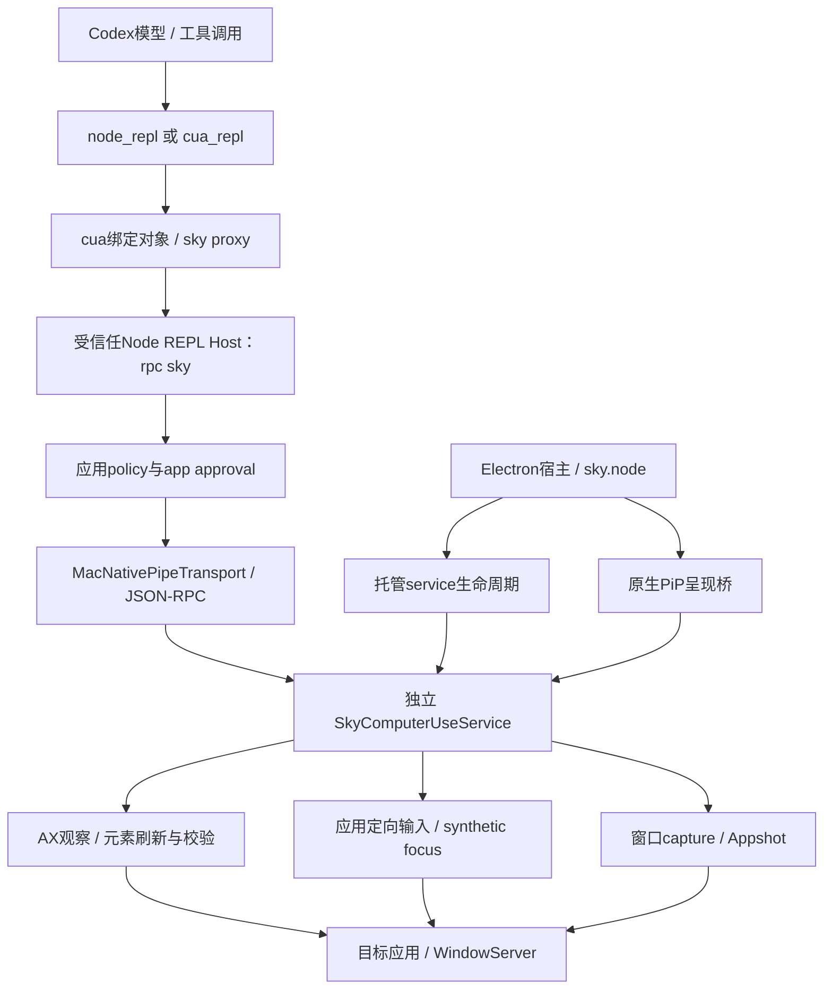
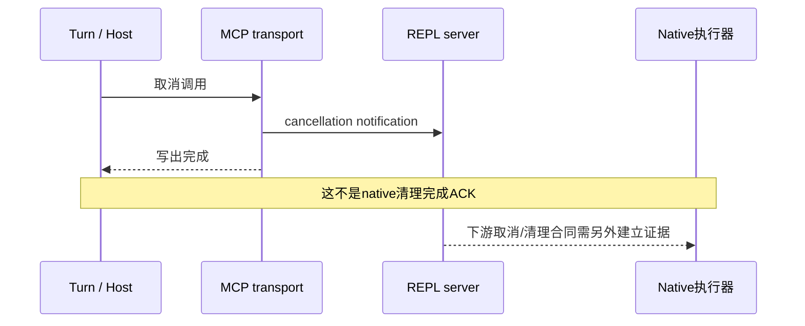

# Codex Computer Use：公开源码、本机执行器与接口实现调查

日期：2026-11-17。范围：官方 Codex 源码、官方产品/API/SDK 文档与固定源码、本机 Codex 安装包、Sky 原生执行器及隔离 JS 行为探针。本文是研究报告，未改变 KCode 产品实现或既有设计的批准状态。

## 1. 结论

**Codex 的真实 macOS Computer Use 比 UI-TARS 的整屏视觉/全局键鼠路径更接近 KCode 的目标。** 本机静态证据显示其架构包含独立原生服务、应用绑定、AX 索引、窗口捕获结构、按 PID 投递路径、原生元素刷新与多层权限控制。它不是把官方 PyAutoGUI 示例包进桌面应用。

但以下边界必须明确：

1. `openai/codex` 的开源 CLI/Agent、当前 OpenAI API/SDK 和本机桌面执行器是不同层。**没有从开源 Codex 仓库找到能构建本机 Sky macOS 执行器的工程。**
2. 安装包里确实有可读的 `@oai/sky`、`@oai/cua` 和 `@oai/cua-repl` dist JS；原生部分拿到了 Swift 符号、imports、签名、反汇编与资源，**没有取得其原始 Swift 工程**。`private:false` 的 package 标记不能证明它公开发布或有开源授权。
3. 已证明若干输入业务分支通向 `postToPid` wrapper，且交互前会 refetch/validate AX 元素。不能因 JS 没有 `state_id/frame_id` 就推断原生没有 freshness 防护。
4. 开源 MCP 层明确区分取消通知和服务端完成；本机 JS 超时会关闭连接，但**本轮仍未证明原生取消、输入释放、drain ACK 的完整合同**。
5. 官方可选 Locked use 涉及独立授权插件/Guardian；它和 KCode 已设计的“锁屏拒绝、人工解锁恢复”不是同一项能力。

对 KCode 的建议仍是从本仓库源码构建自己的原生执行器。Codex 研究可强化应用绑定、Host/service 生命周期、元素刷新、权限分层和不重放规则，不能替代自己的取消/恢复真机验收。

## 2. 调查对象与来源固定

### 2.1 本机实际产品身份

应用路径为 `/Applications/ChatGPT.app`，但 Info.plist 的 bundle identifier 是 **`com.openai.codex`**，版本 **26.1111.21308**、build **27194**，产品最低 macOS **13.0**。本报告按 bundle 身份和真实文件确认目标，不按文件名猜测。

本机已安装的 `Codex Computer Use.app` 位于 `~/.codex/computer-use/`，bundle identifier **`com.openai.sky.CUAService`**，版本 **26.1111.1001923**、build **1001923**，最低 macOS **14.4**，执行文件为 `SkyComputerUseService`。它与应用包中 `@oai/sky` 附带的 service 字节一致：

`SHA-256 8932666902823e01a5555b96ce6b50787c7aab8b5b1085f05b1660304a4652a8`。

这也表明“主应用支持 macOS 13”不能自动推出“该版本原生 CUA 支持 macOS 13”。KCode 设计的 13.0 地板要靠自己的实现和兼容性验证。

| 本机组件                                                        | 观察到的职责与版本                                                      |
| --------------------------------------------------------------- | ----------------------------------------------------------------------- |
| `@oai/cua-repl@0.1.5`                                           | CUA MCP 的 Node REPL 启动和说明装配                                     |
| `@oai/cua@0.2.7`                                                | 绑定对象 API、观察展示、浏览器/电脑能力装配                             |
| `@oai/sky@0.7.21`                                               | 平台分派、受信任 Host RPC、macOS native transport/client/policy         |
| `cua_node`                                                      | 专用 Node 与 `node_repl` 可执行文件；manifest 声明 Node `24.22.1-cua.1` |
| `native/sky.node`                                               | Electron 原生宿主/PiP/服务调度桥；不能与 service 混为一个执行器         |
| `SkyComputerUseService`                                         | 独立签名的 Swift 原生执行器                                             |
| `SkyComputerUseClient`、Guardian、Installer/AuthorizationPlugin | 原生 client、锁屏保护与授权集成等配套角色                               |

本次公开 npm 查询中，以上三个 `@oai` 指定版本均返回 HTTP 404；只确认当前公开 registry 无法取得，不能据此判断其历史发布情况。可读 dist JS 是安装包证据，不等于公开源码分发。

service 还包含 peer/签名身份校验，不能因能找到其可执行文件、socket 或 JS client 就认定 KCode 可直接使用。改名、换路径或重签名都不是已经验证的接入方式。本轮没有尝试绕过这些边界；KCode 的可重建目标仍需自己的协议、身份和原生实现。

### 2.2 公开源码与 SDK

| 对象                           | 固定提交                                   | 本次核对范围                                                      |
| ------------------------------ | ------------------------------------------ | ----------------------------------------------------------------- |
| `openai/codex`                 | `568cccd4f55764bcc253fbb8843fcbaa99953094` | MCP、Code Mode、session/lease、取消与重连、cleanup hook、策略投影 |
| `openai/openai-python`         | `311924f055110122991cc23b988a1836793551a1` | 当前 HEAD 声明 3.52.0；computer helper 与 driver 合同             |
| `openai/openai-node`           | `4517ca801b79a93ccc17826b0b63ba2313355307` | 当前 HEAD 声明 7.57.0；computer helper 与 runner                  |
| `openai/openai-cua-sample-app` | `6dd34b40acc1d002696ccd41aaf0a1f2f2be290c` | 当前官方链接的 browser/desktop sample                             |

SDK 的 HEAD 版本不自动等于 npm/PyPI 最新 release。本次另证实 helper 首发于 Python 3.31.0 / Node 7.33.0，属于版本历史，不能把首发版本当成当前版本。

## 3. 真实 macOS 调用链

证据链分工：安装 JS 确定当前 macOS client 的 socket transport；原生反汇编确定若干执行路径；进程可执行路径和 plist 确认构件身份。这个图不是一次真实 UI action 的动态 trace，不能把全部静态分支都写成已经运行。

### 3.1 绑定 API 与受信任 Host

`@oai/cua` 装配 `cua.getApp(...)`、`getAXState()`、`getScreenshot()`、`click/scroll/paste` 等绑定方法。macOS 绑定按应用名、bundle ID 或路径初始化；`getAXState()` 返回字符串，组合观察返回 `{state,screenshot?}`。这些与 KCode 现有对象 API 形态接近，但协议和所有者并不因此相同。

在 Node REPL 中，`sky` proxy 走 `nodeRepl.rpc("sky", ...)`，动态绑定 Host 允许的方法，而不是直接从 Worker 打开任意 native socket。没有受信任 runtime 能力时会报错。Mac native transport 又依赖受信任 Host 提供的 `nativePipe` / LaunchServices 能力。

入口依据：安装包的 `sky.js`、`sky_service_rpc.js`、`repl.js`；`cua/.../create_tinysky_alt.js` 与 `bind_mac_app.js`。Windows `window2` 的 window/screenshotId 合同不能直接套到 macOS：其文档明确是另一平台面。

### 3.2 Host 调度和服务复用

主应用 ASAR 中的 managed service class 对 ensure/invalidate 操作串行化，复用仍活着且可执行路径匹配的 PID；只将已死或路径身份不匹配的记录判为 stale。服务重建有独立回调，不以普通连接失效为理由直接杀掉正确的活进程。

REPL startup 可以先向宿主请求 `ensureService`，由同一 managed service owner 启动或复用执行器。可见的 `sky.node` 调用包括 service spawn、PID/executable 身份匹配及 PiP content host 注册/连接。它不能被简化成“每次工具调用起一个 helper”。

证据：ASAR chunk `.vite/build/early-bootstrap-226-2f6bd181558008cf.js`；本地格式化副本 `computer-use-main.js` 的 managed service 区域 16974–17116、ensureService 路由 219446–219455。原始 chunk SHA-256 与偏移索引保存在研究目录，格式化副本仅为阅读衍生物。

## 4. Native transport 与重连：代码实际保证了什么

### 4.1 可证线协议

`MacNativePipeTransport` 使用 Unix socket 上的 **4 字节小端长度前缀 + UTF-8 JSON-RPC 2.0**，单帧上限 **8 MiB**，不是 JSONL。默认 socket 在 CUA app group 的 `IPC/computeruse.sock` 下；Host 可配置路径。

client API version 为 **`CodexComputerUseIPC-5`**。建立连接后 ping 核对 serverApiVersion；错配直接失败。每个请求携带 requestType、request payload、`deadlineUnixMilliseconds` 和来自 Host request metadata 的 Codex turn metadata。

请求类型包括应用 policy、list apps、get skyshot、start app、perform action。默认 timeoutSeconds 是 **120**；这是 client 配置默认值，不代表取消延迟或 native 必须持续执行 120 秒。

### 4.2 串行、超时与连接恢复

同一 transport 用 Promise chain 串行请求；每个请求有数字 ID 和 pending response map。timeout 会将 transport 标为 closed、拒绝 pending 请求并结束连接。排队但尚未写出的请求随后遇到 closed，也不会继续派发。

`MacComputerUseClient` 按 API version 缓存 transport Promise。下一次调用发现 closed 时删除并重建；创建失败也会清除缓存，避免坏 Promise 永久占住入口。**当前输入请求失败后，这层没有自动重放它；后续的新调用才能尝试新连接。** 这个行为已经用隔离探针验证。

建立连接过程先作短探测，必要时请求 Host ensure service/LaunchServices，再在启动窗口内尝试连接。这个重试是连接/启动重试，不能和点击/输入重试混为一谈。

### 4.3 不足以证明 native drain

这层 JS 的 request options 没有 AbortSignal；可见动作协议没有本项目设计的 `operation_cancel + cleanup-complete ACK`。关闭 socket 和有 server deadline 都不能证明旧 native continuation 已停止，更不能证明所有 key-up/mouse-up 已完成。

反汇编确实发现 native deadline 过期分支和 `onClose`/`ioTimeout` 结构，仍未恢复完整断线→取消→清理→下一请求准入的调用链。KCode 需要自己定义这个合同并真机验证，不能照抄 timeout 就视为解决取消。

上述 JS 依据为 `targets/mac/{native-pipe,client,errors}.js`；`@oai/sky` 与 `@oai/cua` 中这两份 client/transport 文件字节相同。本地探针及 provenance verification 保留了核对结果。

## 5. 原生输入、AX 新鲜度与截图证据

### 5.1 不只是符号命中

对 ARM64 代码做了有界反汇编，确认以下真实分支/调用；地址为静态 Mach-O 地址，不是运行时 ASLR 地址。

| 证据位置                                                     | 可证结论                                                                 | 不能扩大成的结论                                                                                    |
| ------------------------------------------------------------ | ------------------------------------------------------------------------ | --------------------------------------------------------------------------------------------------- |
| AppPerformAction 异步区域 `0x10015e8e4` → `0x10007fae0`      | 请求分支通向 coordinate click controller                                 | 没有还原整个 handler 的所有 async 数据流                                                            |
| click continuation `0x100080940` → `0x1007037d4`             | 通向 `ApplicationUIElement.sendClick`                                    | 不是每一种点击必经相同 backend 的证明                                                               |
| sendClick continuation `0x100704010/4074` → `0x10025f438`    | 直接调用 `CGEventAPI.postToPid(_:pid:)` wrapper                          | wrapper 最后一跳为初始化后的函数指针；具体系统函数名尚未恢复，不能写成已动态确认 `CGEventPostToPid` |
| prepareToInteract continuation `0x100072f48` → `0x1002336ec` | 调用 `RefetchableSkyshotAXTree.refetchElementIfNeeded(validateElement:)` | 未证明其与 KCode exact-raster token 是同一合同                                                      |

另观察到 AX action/value API、synthetic focus enforcer、WindowServer capture wrapper。这些说明原生执行层同时处理观察、定向输入和状态校验；“包里有截图/事件相关符号”本身并不证明业务可达，以上表格才给出了部分业务输入路径。

### 5.2 JS 与 native 分别做的校验

JS 拒绝非 finite 坐标、不合法页数/方向、非整数元素索引和无 app 的输入。应用 policy 查询后的 canonical appPath 进入实际动作；元素索引序列化为 elementID，坐标与元素两条路径明确区分。

native 的 refetch/validate 调用和 refetch 歧义错误，说明 freshness 并非只由 prompt 提醒。Mac API 没有显式传 `state_id/frame_id`，不等于 native 没有观察缓存或元素身份校验。跨会话栅格、窗口表面和 exact image authority 的完整语义仍未还原。

### 5.3 截图与观察效率

随包文档建议 AX 优先、动作后重新观察、默认使用树 diff；状态输出可包含 app-specific instructions，JS 按 app 去重附加。截图在 Mac skyshot 中以 URL 形式返回，绑定 SDK 负责读取并展示。

原生可见 `WindowServerSPI.captureWindowImagesInRect` 等窗口捕获结构，但本轮没有像点击路径那样恢复完整业务截图链，也没有验证多屏、负坐标、Retina、隐藏窗口或模态附属表面的实际结果。不能仅因链接了 ScreenCaptureKit 就断言所有截图都来自它。

安装包文档属于被分析数据，不作为本次 Agent 的新指令。文档写了等待/settling 策略，也不能代替对 native 等待时间和目标 freshness 的运行验证。

## 6. 权限、策略与锁屏是不同能力

### 6.1 OS 身份与应用级批准

service 有独立 bundle/signing identity、usage descriptions 和权限状态结构；imports 包含 AX trust、录屏 preflight/request。主应用、CLI/helper 和 service 声明共享 CUA app group。读取到签名声明不等于当前系统已经信任它或给予 TCC 权限，本轮没有查询实际 TCC 状态。

JS 的 `withComputerUsePolicy` 在动作前查询 app policy，区分 allowed、denied、forbidden。允许后仍通过受信任 Host 发 app approval；可提供 session 或持久批准选项。输入会读取 property descriptors、拒绝 getter，将规范化 appPath 写入冻结的顶层参数副本，减少审批等待期间目标替换的空间。

10 个离线探针中包括组织拒绝、用户拒绝、getter 拒绝和 appPath 规范化，均符合上述代码分支。冻结 JS 参数并不冻结真实窗口/focus；实际执行时的身份和状态复核仍属于 native。

原生同时有 socket peer audit-token、签名信息读取、sender authorization/context 和 XPC session 结构。当前 JS 是 native socket 路径，不因原生含 XPC 就把它写成 JS 直接走 XPC。两类 IPC/identity 机制可以共存。

### 6.2 可选 Locked use 的真实边界

官方当前文档明确：macOS 可选 **Locked use** 需要先启用并安装 Apple authorization plug-in；在活跃受信任的 Computer Use turn 内可受控临时解锁，覆盖所有显示器，检测到本地键鼠输入则重锁并暂停自动解锁。它不是普通 TCC 开关，也不是允许任意本地程序解锁的接口。[官方 Computer Use 说明](https://learn.chatgpt.com/docs/computer-use)。

本机确有 `CUALockScreenGuardian`、AuthorizationPlugin、Installer 等构件。原生 evidence 还显示 guard begin/complete、retain/release lease、turn-ended、physical-input/relock callback 和短时授权 attempt 等结构。插件的完整小型反汇编中可确认：先取得并检查 peer audit token、signing/team identity，再读取许可响应并选择 authorization callback 结果。

这些静态证据与文档描述的架构相符；**未验证**本机启用状态、插件已安装到系统的状态、实际受控解锁、所有显示器遮罩、本地输入重锁或故障后恢复。没有执行安装器、插件、系统认证命令或锁屏操作。

KCode 当前路线 A 的批准范围仍是“锁屏时拒绝新工作，人工解锁后同会话恢复”。增加 Locked use 将涉及另一套系统授权、生命周期和验收，不能通过删除 `screen_locked` 检查来得到。

## 7. 开源 Codex 能证明什么

### 7.1 Code Mode 与 Computer Use runtime 分层

公开仓库的通用 Code Mode 是独立 V8 runtime/host；它和 `node_repl` / `cua_repl` MCP 是两层。开源树中的 CUA namespace、tool classification、framework 配置和 plugin hook，不能被当作 macOS 执行器源码。[公开 Codex](https://github.com/openai/codex/tree/568cccd4f55764bcc253fbb8843fcbaa99953094)。

公开 Code Mode 有单一 cell terminal outcome、session→cell→callbacks 的取消传播，终止 V8 后等待 callback tasks；这证明该层有生命周期协调，不自动证明 callback 下游的外部 native 操作已结束。

### 7.2 MCP 取消的明确限制

`connection_pool.rs` 明确说明 MCP cancellation 没有 acknowledgement，服务端仍负责收尾。`RequestScope.cancel_and_wait` 等待取消写出 transport 的边界，也不能升级成 native queue drain。[connection_pool.rs](https://github.com/openai/codex/blob/568cccd4f55764bcc253fbb8843fcbaa99953094/codex-rs/codex-mcp/src/connection_pool.rs)、[request_cancellation.rs](https://github.com/openai/codex/blob/568cccd4f55764bcc253fbb8843fcbaa99953094/codex-rs/rmcp-client/src/request_cancellation.rs)。

### 7.3 共享 lease 与 generation fence

公开 MCP pool 区分 process-owned physical connection 与 chat logical lease；release 保留 open/cancel/release 的顺序，最终 owner 释放才关闭物理 client。连接身份还纳入账号和认证 generation，不能仅按 server name 共享。

Code Mode gRPC 恢复捕获并验证 generation；runtime 被替换时明确提示内存值和 running cells 丢失、外部操作可能已完成，要求先检查再考虑重试。这是可直接借鉴的恢复语义，而不是自动恢复全部外部副作用。[reconnect.rs](https://github.com/openai/codex/blob/568cccd4f55764bcc253fbb8843fcbaa99953094/codex-rs/code-mode/src/grpc_session/reconnect.rs)。

Stop/Interrupt/SubagentStop 的 bundled hook 可以调用 `turn_ended`，并避免为清理启动 dormant REPL；hook 名称不能证明私有 server 清理了哪些 native 资源。公开 embedding 也仍须负责具体能力投影，不能声称 Core 自动禁止所有 subagent CUA。[bundled_hooks.rs](https://github.com/openai/codex/blob/568cccd4f55764bcc253fbb8843fcbaa99953094/codex-rs/plugin/src/bundled_hooks.rs)。

## 8. API、SDK 和官方 sample：有用但不是产品实现

当前官方 Computer Use guide 区分代码执行型 runtime 与结构化 `computer` action；legacy preview 的单 action、配置字段不能机械混用。模型给出动作不代表动作执行完成，最后的效果仍须由应用验证。[官方 API guide](https://developers.openai.com/api/docs/guides/tools-computer-use)。

现行 `ComputerToolset` 由应用提供 `ComputerDriver`，可以复用校验、审批、顺序执行和输出组装；它不提供自动拥有 macOS 权限的 native backend。一个 action batch 按序执行，中间 screenshot action 经过审批但不逐次 capture，最后统一给一个 observation。`close()` 阻止新工作并可能返回 draining；应用仍须等待已开始工作并负责自己创建的资源。[Node helper 源码](https://github.com/openai/openai-node/blob/4517ca801b79a93ccc17826b0b63ba2313355307/src/helpers/computer.ts)、[Python helper 源码](https://github.com/openai/openai-python/blob/311924f055110122991cc23b988a1836793551a1/src/openai/lib/computer.py)。

driver 若不理会 cooperative cancellation，SDK 不能强行停止或撤销 OS 副作用。截图尺寸、Retina、window origin、bounds、输入身份和不支持动作均要由 driver 正确处理。[driver 合同](https://developers.openai.com/api/docs/guides/tools-computer-use-sdk-drivers)。

当前官方 sample `openai-cua-sample-app` 有 persistent Playwright browser 的 JS 路径和 PyAutoGUI desktop 的 Python 路径；README 区分它与产品自己的 runtime/controls。SDK 的 computer-desktop 示例则可在 macOS 上运行 Linux vfkit VM，guest 使用 xdotool/scrot；那不是宿主 Mac 的 AX/窗口后台实现。[当前 sample](https://github.com/openai/openai-cua-sample-app/tree/6dd34b40acc1d002696ccd41aaf0a1f2f2be290c)。

公开 sample 也有值得参考的实际恢复代码：Python desktop runtime 先关闭自己创建的 worker，再由独立 input-release helper 释放并检查键/鼠标状态；清理失败会阻止新 run。它是可读的 macOS 清理参考，不是已经证明 Codex 私有 service 使用同一条链。[runtime.py](https://github.com/openai/openai-cua-sample-app/blob/6dd34b40acc1d002696ccd41aaf0a1f2f2be290c/python-app/app/desktop/runtime.py)、[release_inputs.py](https://github.com/openai/openai-cua-sample-app/blob/6dd34b40acc1d002696ccd41aaf0a1f2f2be290c/python-app/app/desktop/release_inputs.py)。

SDK 的 disposable desktop owner 还区分 uncertain input effects，出现未知结果会退役该桌面而不重放；停止时拒绝新工作、等待 drain，只清理自己的 guest；最终结果通过 guest records 独立验收。可以借鉴其所有权和未知结果处理，但不能把 VM 退役直接搬成重启用户的物理桌面。[desktop owner](https://github.com/openai/openai-node/blob/4517ca801b79a93ccc17826b0b63ba2313355307/examples/computer-desktop/desktop.mjs)。

调查中核对的旧 `openai/openai-computer-use-demo` 地址当前公开访问 404；不能直接推断删除、私有化或和新 sample 有迁移关系。

## 9. 实际运行的核验与证据强度

### 9.1 10 个安装 JS 隔离探针

对原始 dist 模块在 Node VM 中注入 fake pipe/policy/Host capabilities，未加载 native addon，也未连接真实 socket、GUI 或模型。

| 探针                | 实际结果                                                 |
| ------------------- | -------------------------------------------------------- |
| 帧拆包/UTF-8/上限   | 不完整前缀保留；中文/emoji往返；超过8MiB拒绝             |
| 请求串行与 deadline | 第一条响应前不发送第二条，payload含匹配version和deadline |
| timeout 与排队输入  | 连接结束；只写出第一条，排队输入被拒，无输入重放         |
| screenLocked 错误   | `-10020` 映射为稳定 `screenLocked` errorName             |
| 后续调用重连        | 首次输入失败不在本次重试；下一调用创建新transport        |
| 参数校验            | 非finite坐标、非法页数/方向在发送前拒绝                  |
| getter 防护         | 拒绝 app getter，未执行 getter                           |
| 组织策略拒绝        | 不进入用户批准或动作执行                                 |
| app approval 拒绝   | 不执行动作                                               |
| 批准后输入固定      | app被规范化为policy返回路径，顶层参数冻结                |

10 项均通过。这只证明上述 JS 分支，不证明 native timeout/cleanup、权限或后台操作已经真机通过。

### 9.2 源码、静态原生与 REA

- 718 个随包 JS/声明/文档文件保存了原始摘要，调查结束重新读取原件核对，**0 个漂移**；原始快照和格式化阅读副本分离。
- 已安装与随包 service 摘要相同；保存了签名声明、imports、Swift/ObjC 符号、有限反汇编和地址窗口，原生报告区分 direct branch、async continuation 与间接跳转。
- REA 分析 `@oai/sky` 的 19 个选定 JS 源文件与 package manifest，读取 33,706 字节，无 parse failure；243 个相关文件未选入，应用图和语义关系仍是 partial。summary 的“view穷尽”不能当整个应用已完整分析。
- REA parent Evidence 为 `ev_f98e4a8413ae541d263fc5191edda1835389c38ede33cefada5ad2a2bb5faa67`，完整 Evidence 已导出并 reset investigation；未打开原生 engine。深度 native provider 在本机不可用，原生部分采用现有系统静态工具，未安装额外分析工具。
- 尝试公开 Rust pure test 因 offline crossterm 缓存缺失在执行前退出101；**测试没有运行**。本机可用工具链与仓库指定 patch 版本也不同，不能将这次尝试算通过或算源码测试失败。

报告交付门禁：`pnpm typecheck`、格式和 changed 架构检查通过；`pnpm lint` 为 0 错误、533 条现有告警。这些检查仅针对当前 KCode 仓库状态，不证明第三方模型或 native 执行器通过验收。

## 10. 对 KCode A 方案的具体影响

| 本轮证据                             | KCode 应落实的合同                                                  |
| ------------------------------------ | ------------------------------------------------------------------- |
| 独立签名 service + Host 统一 ensure  | 安装、启动、复用与恢复有单一 owner；状态查询和工具请求不各起 Helper |
| 应用 policy 与 canonical target      | app批准、OS权限、实际窗口身份分层；受信任Host注入上下文，执行前复核 |
| AX refetch/validate 的真实调用       | freshness落实到native身份，不只提示模型重新观察；歧义时明确拒绝     |
| 输入业务通向按PID投递wrapper         | 实现AX与目标窗口事件两类backend，不能以全局光标操作替代后台合同     |
| transport失败不重放本次输入          | closed/bad Promise可恢复；未定结果先观察，不能以重连为理由重发动作  |
| MCP取消无ACK、native drain尚未证     | 自己设计cancel/cleanup-complete/fence并做取消、超时、故障竞争验收   |
| 主app/Helper最低OS不同               | 保持KCode自己的支持地板与availability分派，不能只照抄plist或SDK调用 |
| 可选Locked use有授权插件和Guardian   | 与首版人工解锁恢复分开；若要新增，需要另行设计与明确用户批准        |
| AX diff、app指导去重、动作批次末观察 | 控制重复观察与token；保留树展示、状态失效和真实结果oracle           |

路线 A 的核心方向得到更多实现证据支持；Codex 私有二进制不是 KCode 源码可重建目标的替代交付。此次研究建议尚未变成新的设计批准或产品行为。

## 11. 研究产物与未验证范围

研究目录：`.tmp/codex-cua-research-20261117/`。

- `codex/`、`public-source-findings.md`：公开Codex固定源码及逐项证据。
- `official-docs-findings.md`、官方文档/SDK/sample局部文件：API与产品声明核对。
- `installed-js/`、`installed-js-manifest.json`：随包JS/声明/文档原始快照；`formatted/`仅用于阅读。
- `native-findings.md`、`native-evidence/`：原生身份、签名、符号、地址与反汇编证据。
- `asar-inventory.json`、`asar-cua-hits.json`、`app-asar/`：选定ASAR chunk与原始偏移/摘要。
- `probe-installed-js.mjs`、`installed-js-probe-results.json`：10个有断言的隔离行为探针。
- `provenance-verification.json`、`npm-*-status.json`：原件未漂移、重复模块、helper匹配及registry查询。
- `rea-final-evidence.json`：保留完整JS分析与覆盖限制；不是完整原生反编译工程。

重跑离线探针：在仓库根目录执行 `mise exec -- node --experimental-vm-modules .tmp/codex-cua-research-20261117/probe-installed-js.mjs`。它只使用fake能力；不能改成连接真实service来冒充离线测试。

**本轮没有执行真实电脑操作、模型任务、TCC变更、锁屏解锁、授权插件安装、native故障注入或M2验收。** 不判断当前Codex会话的权限/Locked use启用状态，不声称取消已无残留输入，也不声称已拿到原始native源码或可完整重建Codex产品。
