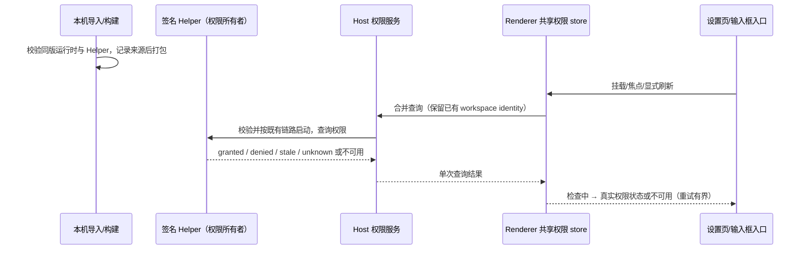
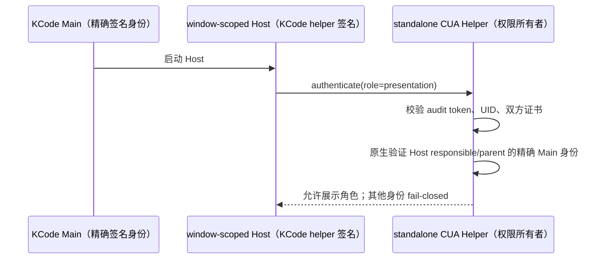
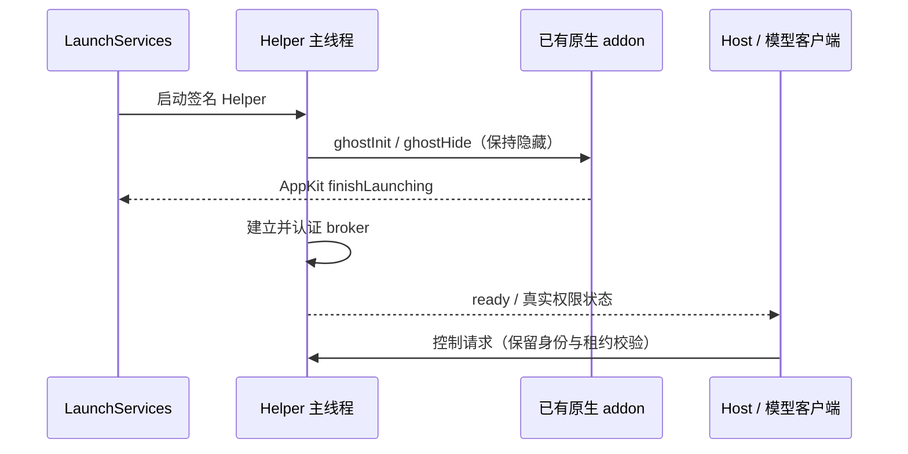

# Computer Use producer 检测

## 规则

Computer Use 的真实实现来自 workspace 包 `@zcode/zcode-cua`（producer）。开源导出用 `packages/zcode-cua`
占位包替换它，占位包在 `package.json` 声明 `zcodeCuaPlaceholder: true`，所有能力 fail-closed。

占位包保留公共 `build` 和 `tsconfig.json` 入口，构建只检查随包类型声明。
日志回调的 traceId 与参数类型和真实 producer 一致，使公共调用方无需按发行版本分支。
根单测引用的 `vitest.config.ts` 也必须存在，运行占位执行入口和 broker 的不可用契约测试。

开发、构建与打包中只服务于真实 Computer Use 的步骤，必须先检测到真实 producer 才执行；
检测不到时跳过，不能让开源树的入口因为缺少私有产物而失败：

| 步骤                                                                   | 位置                                                  |
| ---------------------------------------------------------------------- | ----------------------------------------------------- |
| 开发启动构建 macOS Helper、注入 Helper 环境变量                        | `scripts/dev-desktop-env.mjs`                         |
| 开发态暂存 Computer Use 插件的原生依赖（Sharp）                        | `scripts/stage-dev-cua-plugin-runtime.mjs`            |
| Windows 运行时资源准备 `prepare:windows-cua-helper`                    | `packages/desktop/scripts/prepare-runtime-assets.mjs` |
| 打包附带 macOS Helper、Windows Helper 资源，打包后的 Helper 校验与定稿 | `packages/desktop/electron-builder.config.js`         |

Sharp 的暂存与校验仍以“producer 是否声明 Sharp 依赖”为准（`isSharpRequiredByComputerUse`），
与本检测一致：真实 producer 声明 Sharp，占位包不声明。

## 所有者与接口

- 唯一判定：`packages/desktop/scripts/computer-use-producer.mjs` 的 `readComputerUseProducer` /
  `isRealComputerUseProducerInstalled`。从桌面包目录向上查找最近一次安装的 `@zcode/zcode-cua`，
  读取清单的 `zcodeCuaPlaceholder` 字段。
- 构建配置同步求值，判定只做一次小文件同步读取。

## 验收

1. 闭源（真实 producer）：上述步骤行为不变。
2. 占位包：`pnpm dev:desktop` 的准备脚本可加载，开发态插件运行时暂存返回空，Windows 不准备 Helper，
   打包不附带也不校验 Helper。
3. 单测：`packages/desktop/test/placeholderProducerDetection.test.ts` 覆盖真实、占位、未安装三种情况与暂存跳过。

## 本机 KCode 恢复（2026-11-16）

本机两个源码 checkout 都只有占位 producer；`/Applications/ZCode.app` 3.18.2 提供同版本真实
JavaScript 运行时和官方 Developer ID 签名的 Helper。用户明确授权恢复时，可从该本地产物
提取 CUA 公共接口及其依赖闭包，作为本机 producer 输入；不得替换 Agent/Core、复制用户数据、
引入官方应用启动副作用或取消签名、socket peer、token、freshness 等校验。

- 本地导入产物记录来源版本、构建提交与 SHA-256，隔离保存在 gitignored 目录；不开源或提交私有产物。
- 所有消费方解析同一个导入 producer，桌面打包从同一来源附带经过验证的 Helper（本机身份适配见下）；原源码占位包与
  通用开源构建行为保持不变。导入失败直接停止构建，不生成部分可用的 Release。
- Helper 继续拥有权限真值，服务只查询与映射；Renderer 共用现有权限 store，不新增权限缓存。
- 打包 Main 的权限引导与 Host 必须使用相同的 production 运行环境、编译期产品 variant 和随包 Helper；
  不继承 shell 的开发安装 variant。KCode 不得再指向 `computer-use/dev` 或 `0.0.0` 安装计划。
- standalone 状态探测复用 producer 的认证健康检查（`authenticate` → `broker_info`），
  单次探测限时 300ms。不得发送协议未定义的 `ping`，socket 关闭或无响应必须结束探测。
- 正常权限结果包含 `accessibility` / `screenRecording`，不要求 `available: true`；
  显式 `available: false` 才是不可用分支，空对象不能当作权限真值。
- 首次权限查询只显示“正在检查权限”，不能在未收到 granted 前声称“已授权”。收到不可用结果后
  明确显示不可用和可重试入口，不能继续展示普通授权状态；查询异常用尽既有重试后也应结束等待。
- 不因修复展示而自动截图、修改系统 TCC 数据或绕过授权。功能探针仍需要显式用户操作。

验收：导入模块无 Host/MCP 自动启动副作用；真实 broker 查询可用；未授权不误报 granted；
异常和不可用查询可结束等待并重试；macOS 本机设置页展示与 Helper 返回一致；完成一次可恢复的
真实电脑操作及观察；打包/安装后从新 KCode 进程复验。保留开源占位 producer 的工程回归测试。

本机恢复证据：官方包 3.18.2 / `2681f4af` 的 CUA 0.6.5 可提取为独立运行时，原 Helper
完整签名校验通过。首次启动因 KCode 不具备官方 Apple Team 身份而被 launcher 校验拒绝。
REA 随后提取到 Helper 完整入口，使下述独立证书适配成为可行方案；不使用 unsigned-launcher /
any-peer 开关绕过校验。

### 本机证书身份恢复约束

REA 从官方 Helper 的 Node SEA 容器提取到完整 CJS 入口（源 SHA-256
`b04ffba2a8d783a00404ea0ee92ea3d8471c58d529acf46ea4d83e393296718d`），无需修改原生 addon。
本机原生 `verifyProcessCodeSignature` 实测可以严格验证 MyDesk 固定证书与 bundle identifier，
拒绝错误 identifier 和外部 Node。基于此，本机 KCode 导入产物使用独立身份，不占用官方 ZCode 权限主体：

- launcher 固定 `dev.zcode.app.kcode` 与本机证书指纹；peer 固定同一证书，并保留 audit token、
  同 UID、responsible/parent 进程验证；展示控制只接受 KCode 身份。设置页启动的 standalone Helper
  没有 `launcherPid` 时，已通过上述校验的 `dev.zcode.app.kcode.helper` Host 还必须由原生签名
  校验确认其 responsible/parent 是精确 KCode 主进程身份，才可取得 presentation 权限；
  不能仅把所有同证书子进程加入展示白名单。
- 本机 producer 必须识别桌面已配置的 `kcode` 安装变体，安装到 `computer-use/kcode`；
  Host、Agent 与 Helper 共用独立 `kcode-cua-<uid>` socket 命名空间，避免正式版与 KCode
  互相探测或复用不匹配的 Helper。显式 socket 参数和非法变体拒绝规则继续生效。
- Helper 固定独立 bundle identifier `dev.zcode.cua-helper.kcode`，与 launcher 使用同一证书；
  installer 验证完整签名、精确证书和 identifier、版本、build、架构。签名不匹配仍立即拒绝。
- 本机自签安装不声明 Apple notarization；精确证书验证取代官方 Apple Team/Gatekeeper 分发身份验证，
  不使用 unsigned launcher、any peer 或环境变量扩展信任集合。
- 修改仅发生于 gitignored 本机导入产物，原始官方应用与签名产物只读保留；记录导入、适配、签名后哈希。
  node_modules 中所有 CUA 消费链接统一指向同一导入包，不引入第二条权限服务。
- 必须验证外部进程/错误身份被拒、KCode 冷启动权限查询成功、真实可恢复操作和 freshness 校验仍生效，
  以及签名和资源在安装后仍完整。若任一验证失败，不报告电脑控制修复完成。

权限按钮的异步回调绑定当前 permission service 与 workspace context；服务或工作区变化后不得继续
使用旧闭包查询或触发授权。插件总开关回调只依赖其实际读取的插件上下文，避免无关重建。

### 2026-11-16 本机授权后的运行时复验

系统设置勾选权限后，旧 Helper 仍报告 screen recording denied，新启动进程报告 granted；
重启 Helper 后设置页收敛为两项已授权，无需重启 KCode 或回收 Agent。Helper 空闲五分钟后的
`idle_timeout_reached` 是正常退出，不据此判定应用无响应。

另外发现 standalone Helper 的展示鉴权缺口：Host 的签名 identifier 为
`dev.zcode.app.kcode.helper`，旧适配只认主进程且没有 launcher lineage，导致
`presentation authority requires a verified ZCode host peer`。本机身份适配应恢复上述精确父进程证明；
不改 producer 通用签名、权限、元素 token 和 freshness 规则。验收须覆盖正确 Host 父进程通过、
同证书但非 KCode 父进程拒绝、外部 Node 拒绝，以及真实截图、AX 读取与可恢复的原生操作。

### 2026-11-16 已安装模型链路复验

设置页和原生探针通过不能代替模型链路验收：真实配置冷启动曾复用同版本的 node-repl
占位缓存，实际模型调用仍报不可用。node-repl 构建身份必须包含完成产物的摘要，按既有
seed 锁自动更新用户缓存；详见 CLI plugin-compat 的 build identity 合同与 CU-58。
恢复的 ESM 产物重新 bundle 时也须通过 import/MCP smoke，避免 createRequire 导入名
与宿主 banner 冲突。验收不手动清除旧缓存；运行时需观察、修改、保存专用 TextEdit 文档。

### macOS Helper 启动就绪

Helper 的 broker 可连接与 macOS 应用启动完成是两个不同条件。签名 Helper 负责在启动时调用
原生模块已有的 AppKit 初始化，再保持覆盖层隐藏；完成初始化后才对外报告 broker ready。
不能等待首次控制权申请、PiP 或鼠标动作才初始化，也不能通过延长 `open` 超时或外部
`lsappinfo signal` 伪造就绪。权限查询仍由原 Helper 返回，不改变 TCC 主体、peer 校验和控制权租约。

本机证据：同一签名 Node SEA 探针在只加载 addon 后为 `!cgsConnection !signalled`，
调用已有 `ghostInit()` / `ghostHide()` 后两标记均消失。REA 原生反汇编确认
`GhostInit → EnsureGhostInit → NSApplication.finishLaunching`；其 AppKit pump 复用 libuv。
此证据确认启动初始化遗漏，Finder 的重复打开和真实模型操作仍须分别验收。

本地恢复包每次改变 Helper payload 时，必须从 payload 摘要生成新的 build ID，
同步写入 Helper Info.plist、Host 与模型侧安装器，并传给 node-repl bundle 的构建身份。
保留已安装旧 Helper 验收自动升级；不得靠手动覆盖用户安装目录来证明升级成功。

验收：设置页先启动和独立打开均能结束 macOS 启动阶段；重复打开不出现“不响应”；
真实模型可观察、编辑并保存专用验收文档，空闲自退及下一次按需启动继续有效。
