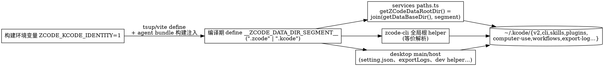

# KCode 与 ZCode 完全独立（数据层镜像隔离）设计

- 日期：2026-10-20
- 状态：待评审
- 前置：`docs/desktop/zcode-preview-packaging.md` 追记 2026-10-20（kcode 并排安装档，已实现）
- 分支：kcode

## 1. 背景与目标

kcode flavor 已实现并排安装（独立 appId/userData/单实例锁/Helper variant），但业务数据仍共享 `~/.zcode`，导致：

- 远控设备身份（`webRemoteControlRelayV2Device`，存于 `~/.zcode/v2/setting.json`）被两个 app 复用，relay 单 deviceSid 单连接，两 app 同时开远控互踢（`KICKED` → `session-conflict`）。
- 设置互写、会话/任务/凭据/插件/skills/agent 数据库混在一起，版本差异带来 schema 漂移风险。

**目标（用户已确认的边界）**：

1. **完全独立**：数据、凭据（登录态）、设置（含远控身份）、插件、skills、agent 数据库全部各自一套；KCode 首次单独登录。
2. **镜像布局**：KCode 的全局根为 `~/.kcode`，目录结构完全镜像 zcode 的 `~/.zcode`（`~/.kcode/v2/...`、`~/.kcode/cli/...`）。
3. **真实 HOME 不动**：KCode 内的 Bash/git/ssh 继续用真实 HOME 正常干活（gitconfig、ssh key、shell rc 全部照旧）。
4. **上游零变化**：默认构建（production/preview）一切行为不变；`.zcode` 仍是默认 segment。

非目标：云端隔离（同一生产后端、同一账号体系，两边可登同一账号）；`zcode://` scheme 分离；workspace 相对路径改名（见 §5）。

## 2. 核心决策

| 决策 | 内容 | 理由 |
| --- | --- | --- |
| 镜像布局 | `~/.kcode` 全镜像 `~/.zcode` 结构 | 用户明确选择；目录语义直观 |
| 编译期 segment 常量 | 新增 `ZCODE_DATA_DIR_SEGMENT`（默认 `".zcode"`，kcode 构建为 `".kcode"`），以 define 注入所有相关 bundle | 打包 app 从 Finder 启动无环境变量，身份只能编译期折叠（与 `__ZCODE_PRODUCT_FLAVOR__` 同一模式） |
| 只改全局根派生点 | 规则：`join(<home 或 dataBaseDir>, ".zcode", ...)` 的**全局**派生点改走统一解析；`join(<workingDirectory>, ".zcode", ...)` 的**工作区**派生点保持字面量 | 工作区 `.zcode` 是项目内状态，两个 app 打开同一仓库本就应共享 |
| 真实 HOME 不换 | 不改 `process.env.HOME`，不引入恢复机制 | shell/git/ssh 天然正常；避免方案 A 的 spawn 审计风险 |
| 唯一所有者 | services 侧 `packages/services/src/paths.ts`（`getZCodeDataRootDir` 等）为全局根唯一解析点；绕过它的派生点全部收口到这里（或共享同一常量） | 避免第二套写入路径（AGENTS.md 架构原则） |

## 3. 路径解析所有权与注入链

一致性保证：desktop main/host bundle（tsup/vite define）、renderer（无文件系统，不注入）、agent bundle（`scripts/build-desktop-agent-cli.mjs` 透传构建环境，CLI 打包器 define）在**同一次构建**中折叠同一个值。segment 缺省（未注入 define 的 bundle，如独立 CLI、测试）回落 `".zcode"`，与现状一致。

## 4. 改动面（按模块）

### 4.1 services（`packages/services/src`）

- `paths.ts`：`getZCodeDataRootDir()`、`getProviderWorkspaceConfigDir()`、`copyDataDirectory()` 改用 segment 常量。
- `setting/settingService.ts`：settings 文件路径 `join(resolveUserHomeDir(), ".zcode", "v2", "setting.json")` → 统一解析。**远控身份随此文件自动隔离。**
- 其余全局派生点收口（实现计划中列全量清单，当前已知）：`subagents/`、`subagentStorage`、`plugin-sync/`、`settings-sync/`（skills/commands/plugins/AGENTS.md）、`skill-sync/`、`skills/`、`hooks/`、`mcp-sync/`、`zcode-agent/`（log、modelTrajectoryFileTail）、`node.ts:1136`、cua-permission-broker 的安装根若直连 `.zcode` 一并收口。

### 4.2 desktop（`packages/desktop/src`）

- `main/desktopDataBaseDirBootstrap.ts`、`main/index.ts:573`（settings 路径）、`main/exportLogs.ts`（全局 `~/.zcode/cli|computer-use`）、`main/desktopRuntimeEnv.ts:536`（dev helper `ZCODE_HOME` 回退）。
- tsup/vite 注入 `__ZCODE_DATA_DIR_SEGMENT__` define。
- 登录首启（见 §6）。

### 4.3 CLI / agent（`apps/zcode-cli`）

- 全局派生点收口：`adapters/src/storage/session-store/paths.ts`、`adapters/src/context/index.ts`、`adapters/src/auth/shared-credentials.ts`、`adapters/src/storage/workspace-hook-trust-store.ts`、`cli/src/provider-runtime-env.ts`、`cli/src/clipboard-image.ts`、`cli/src/sea-runtime-tools.ts`、`bootstrap/src/provider-endpoint-routing-source-headers.ts`、`bootstrap/src/app/script-workflow-*` 的 `homedir()` 分支、`telemetry` 设备标识等。
- **保持不动**：`join(workingDirectory, ".zcode", ...)` 全部（plugins.ts 工作区配置、subagents 项目级、workflows 项目级、agent-memory、office-runtime 工作区导入目录等）。
- `credential-cipher` fallback key 含 `homedir()`：根变化使 KCode 派生自己的 key——与 zcode 凭据互不可解密，正是隔离语义（预期行为，不是回归）。
- agent bundle 构建链注入同一 segment。

### 4.4 构建与打包

- `desktop-product-identity.mjs` 导出 segment（kcode → `.kcode`），tsup/vite/agent 构建统一取用，单一事实源。
- `ZCODE_DATA_BASE_DIR` 用户自定义数据目录功能保持可用（路径变为 `join(dataBaseDir, segment)`），Windows 安装目录保护逻辑不变。

## 5. 明确不改

| 项 | 原因 |
| --- | --- |
| `join(workingDirectory, ".zcode", ...)` 工作区路径 | 项目内状态，跨 app 共享是正确语义 |
| `claudeNativeSessionImportRepo` 读真实 HOME 的 `.claude` | 数据来源是外部工具，不是 zcode 状态 |
| `zcode://` scheme、云端后端、OAuth client | 个人自用无服务器改动空间；回调问题见 §6 |
| web/server/shared（无 HOME 文件系统派生） | 不涉及 |

## 6. 登录首启（KCode 独立登录）

凭据隔离后 KCode 需首次登录。浏览器 OAuth 回调 `zcode://` 由系统默认 handler 接收（可能是 ZCode）。方案：

1. KCode 检测未登录且用户发起登录时，main 进程通过 `LSSetDefaultHandlerForURLScheme("zcode", dev.zcode.app.kcode)` 把自己设为默认 handler，再拉起浏览器。
2. 登录成功后记录状态；用户可随时在系统设置把默认 handler 切回 ZCode（两个 app 各自登录态独立，互不影响对方已保存的凭据）。
3. 该逻辑仅 kcode flavor 编译进包；ZCode 官方行为零变化。

备选（零代码）：手动 `open` 一次 Finder「显示简介→打开方式」切换。实现按 1/2 做。

## 7. 错误处理与边界

- segment 未注入 → 回落 `".zcode"`（所有非 kcode 构建与现状完全一致）。
- 旧共享数据不迁移：KCode 首启空数据起步（用户明确要全面独立；如需种子数据可事后手动拷贝，不做自动迁移）。
- `~/.kcode` 不存在 → 沿用现有 mkdir 逻辑（各 storage 已有 ensure-dir）。
- 单实例锁、userData、Helper variant 已隔离（前置工作），无交叉。

## 8. 验收场景

| # | 场景 | 预期 |
| --- | --- | --- |
| A1 | 两 app 同时运行 10 分钟，各自聊天/建任务 | `~/.zcode` 无任何新写入（mtime 对比）；`~/.kcode` 生成 `v2/`、`cli/`、`skills/` 等全套 |
| A2 | 两 app 各自登录不同/相同账号 | 各自 `acp-auth` 独立；互不顶号 |
| A3 | 两 app 同时开手机远控 | 各自 deviceSid，同时在线不互踢 |
| A4 | KCode 内 Bash：`echo $HOME`、`git config user.name`、`ssh -T` | 真实 HOME、真实 gitconfig、真实 ssh 可用 |
| A5 | KCode 打开含 `.zcode/`（工作区）配置的项目 | 项目配置照常读取（与 zcode 共享，符合设计） |
| A6 | zcode 官方版全流程回归 | 行为与改动前一致（默认 segment 路径不变） |
| A7 | 设置里自定义数据目录（ZCODE_DATA_BASE_DIR） | 两个 flavor 下均落到 `{dataBaseDir}/{segment}` |
| A8 | 单测：segment 解析、define 注入、各收口点路径断言 | kcode → `.kcode`，缺省 → `.zcode` |

## 9. 风险与护栏

| 风险 | 对策 |
| --- | --- |
| sweep 遗漏某全局派生点 → 该项数据仍共享 | 实现时全仓 grep 规则化清点；可选：新增一个轻量架构测试断言"services/CLI 源码中不允许新增 `join(<非工作区>, ".zcode")` 字面量"（复用 architecture-governance 机制，若成本高则退化为人工 checklist） |
| 上游合并冲突面（~25-35 文件） | 改动保持机械、单行化（`".zcode"` → segment 常量），冲突易解；已与用户确认接受 |
| 两个 bundle 注入不一致（main 用 .kcode、agent 用 .zcode） | segment 只有一个事实源（identity 模块）；验收 A1 兜底 |
| OAuth 回调 handler 切换困扰 | 仅登录瞬间需要 KCode 为默认 handler；文档写明切换方法 |

## 10. 实施顺序（详见后续 implementation plan）

1. identity 模块导出 segment + tsup/vite/agent 构建注入 + shared define 声明。
2. services 收口（paths.ts 为核心）+ 单测。
3. desktop 收口（settings/bootstrap/exportLogs/dev helper）+ 登录 handler 切换。
4. CLI 收口 + agent bundle 注入。
5. 全量验证（typecheck/lint/architecture/受影响单测）+ 构建 + 验收 A1–A8 + 文档更新（zcode-preview-packaging.md 追记或本 spec 状态更新）。
