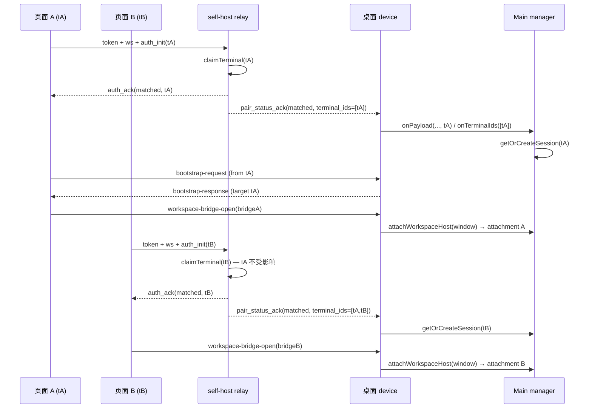
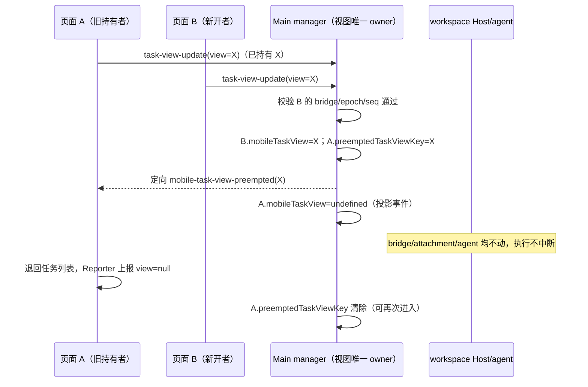

# 手机远控多网页独立会话设计（multi-terminal）

- 日期：2026-10-21
- 分支：kcode（自用 fork，不分发）
- 状态：设计已确认，待实现
- 前置：[自托管 Relay 设计](./2026-10-20-self-hosted-relay-design.md)、
  [Relay V2 共享契约](../web-remote-control/relay-v2-pairing.md)
- 取代：`2026-10-20-self-hosted-relay-design.md` §3.1 中“terminal 新连接无条件接管”
  的语义。device 角色的替换语义不变。

## 背景

当前自托管 relay 的 `(device_sid, role)` 只有一个 owner 槽位
（`apps/self-host-relay/src/domain/relayStore.ts:95`），terminal 认证时新连接无条件替换旧
连接并发送 `KICKED`（`apps/self-host-relay/src/adapters/wsGateway.ts:111-115`）。手机端第一次
KICKED 等 2~5 秒重连，60 秒内第二次进入 `session-conflict` 终态
（`packages/web/src/web-remote-control/adapters/webRemoteControlTransport.ts:389`、
`packages/shared/src/web-remote-relay/domain/retry.ts:26`）。

即使 relay 放开多连接，桌面 manager 每个窗口也只有一组
`currentBridge` / `bridgeOpen` / `mobileViewState`
（`packages/desktop/src/main/webRemoteControlManager.ts:133-149`），第二个页面的
`workspace-bridge-open` 会 dispose 第一个页面的 bridge
（`packages/desktop/src/main/webRemoteControlManager.ts:1041`）。因此“只能开一个网页”是
relay 与 desktop 两层单 owner 共同造成的。

底层 Host 已支持同一窗口的多个 attachment：`attachWorkspaceHost`
（`packages/desktop/src/main/webRemoteControlSharedHostAttachments.ts:107`）每次调用都会新建
MessageChannel 并挂到同一个 window-scoped Host；远程 workspace 的
`attachRemoteWorkspaceSessionHost` 同样按调用创建 attachment。本设计不需要改 Host/Agent。

## 目标

1. 同一桌面窗口、同一个远控链接，可以同时打开多个浏览器页面（手机、平板、电脑浏览器均可）。
2. 每个页面是独立会话：可以打开不同 workspace/task，输入、RPC 帧、视图状态互不串台。
3. 关闭或断网一个页面不影响其他页面；单个页面重连复用原 bridge/attachment，不重建。
4. 官方 relay（`zcode.z.ai`）与旧客户端行为零变化；多 terminal 只在自托管 relay 上启用。
5. 保持现有安全边界：terminal 仍需自托管密钥换一次性 token；relay 不保存业务状态。

## 非目标

- 不做多用户、多账号、跨账号共享。
- 不改造“多个桌面窗口共用同一 deviceSid”的既有问题；它仍会导致 device 连接互踢，与本需求
  无关，保持现状。
- 不新增桌面 UI 的在线页面计数、页面列表或踢人操作。
- 不做跨页面草稿隔离；`mobile:<deviceMid>` 的草稿命名空间保持共享。
- 不修改官方 relay 的服务端实现，也不要求官方 relay 支持多 terminal。

## 术语与状态归属

| 术语           | 定义                                                                              |
| -------------- | --------------------------------------------------------------------------------- |
| `terminal_id`  | 逻辑 terminal 身份。由页面生成，页面加载时一次，页面生命周期内不变；重连复用      |
| `terminal_sid` | relay 为单条 terminal 连接分配的连接级 SID，保留用于诊断与 `auth_ack`             |
| session        | desktop 侧对应一个 `terminal_id` 的会话状态集合（bridge、attachment、视图状态等） |

| 状态                                                     | 唯一 owner                   | 生命周期                                                    |
| -------------------------------------------------------- | ---------------------------- | ----------------------------------------------------------- |
| 设备表、一次性 token、device owner、terminal 集合        | self-host relay `RelayStore` | 进程内存；设备表持久化，连接态重启即清                      |
| `terminal_id`                                            | web 页面                     | 页面加载时生成，内存态，不写 localStorage                   |
| desktop `TerminalSession`（bridge/attachment/视图/缓冲） | desktop manager              | terminal 认证后懒创建；断开后 30s 宽限；device 停止立即释放 |
| task/session/stream/CommandInbox                         | desktop Host/CLI             | 不变                                                        |

## 方案总览

```text
页面 A (terminal_id=tA) ─┐
页面 B (terminal_id=tB) ─┼─ relay terminal 集合 {tA,tB}
                         │    terminal → device: 附 from_terminal_id
                         │    device → terminal: target_terminal_id 定向，缺省广播
                         │
                         └── device WS ── KCode 窗口 WindowControlRuntime
                                              ├─ TerminalSession(tA) → bridge A + attachment A
                                              └─ TerminalSession(tB) → bridge B + attachment B
```

单页时的链路完全不变；多页时 relay 只多维护一个 terminal 集合，desktop 只多维护一个
session map。

## wire 契约扩展

沿用 `packages/shared/src/web-remote-relay/contract.ts` 的严格校验风格；新增字段全部可选，
不改变已有字段的必填性与类型。

| 方向             | 消息              | 新字段                        | 语义                                                                                                                                             |
| ---------------- | ----------------- | ----------------------------- | ------------------------------------------------------------------------------------------------------------------------------------------------ |
| terminal → relay | `auth_init`       | `terminal_id?: string`        | 客户端生成的稳定逻辑身份；缺省时 relay 用连接级 `terminal_sid` 作为生效 id                                                                       |
| relay → terminal | `auth_ack`        | `terminal_id?: string`        | 回显生效 id，供诊断；**仅当 terminal 在 `auth_init` 携带了 `terminal_id` 时才出现**（旧 web 的 strict 解析不认识未知字段，无条件回显会击穿认证） |
| relay → device   | `auth_ack`        | `terminal_ids?: string[]`     | device 认证时的初始 terminal 集合                                                                                                                |
| relay → device   | `data`            | `from_terminal_id?: string`   | 由 relay 附加，标识发送方；终端不能自行提供                                                                                                      |
| device → relay   | `data`            | `target_terminal_id?: string` | 指定接收 terminal；缺省广播给全部 terminal                                                                                                       |
| relay → device   | `pair_status_ack` | `terminal_ids?: string[]`     | 当前在线 terminal 集合，device 的对账依据                                                                                                        |

约束：

- `terminal_id` 与 `identifier` 相同：非空白、1..128 字符、UTF-8 字节数 ≤128。
- `terminal_ids` 为 `identifier[]`，schema 上限 64；relay 运行上限 32。
- 新增字段只允许出现在对应方向。`from_terminal_id` 只在 relay → device 的 `data` schema 中
  定义，terminal 发送会被严格 schema 拒绝并按 `WRONG_PARAM` 关闭；`target_terminal_id`
  只在 device → relay 的 `data` schema 中定义，terminal 发送同样被拒绝。`auth_init` 由
  device/terminal 共用，device 若携带 `terminal_id` 由 relay 忽略（不参与 device 认证）。
- relay 转发给 terminal 的 `data` 只保留 `{type, payload, server_ts}`；`target_terminal_id`
  在 relay 内部消费，不进入终端 wire。
- relay 转发给 device 的 `data` 保留 `{type, payload, from_terminal_id, server_ts}`。
- **分片预算必须为路由字段预留余量**：`encodeWebRemoteControlRpcTransportMessage` 的分片
  大小若按裸 envelope 贴满 1 MiB，desktop 附加 `target_terminal_id` 或 relay 附加
  `from_terminal_id` 后会超过 `maxPhysicalFrameBytes`，合法大 RPC 会被 oversize 拒绝并
  degraded bridge。`WEB_REMOTE_CONTROL_RPC_TRANSPORT_LIMITS` 新增
  `routingFieldReserveBytes: 1024`（identifier 上限 128 字符，控制字符 JSON 转义后
  最坏 6 字节/字符 ≈768 字节，加字段名与引号 <1024），acknowledged protocol 编码调用点以
  `maxPhysicalFrameBytes - routingFieldReserveBytes` 作为分片预算；官方 relay 链路同样
  预留，代价是每片约 0.1% 容量。

## relay 详细设计

### 1. RelayStore

原 `(sid, role)` 单 owner 改为：

- device owner：仍为单槽位，替换语义不变；
- terminal 集合：`Map<terminalId, { owner, meta }>`，同 id 替换，不同 id 共存。

新增/调整的接口（`apps/self-host-relay/src/contract.ts`）：

```ts
claimDevice(deviceSid, meta, owner): { kicked: unknown | null } | null
releaseDevice(deviceSid, owner): {
  released: boolean;
  terminals: { terminalId: string; owner: unknown }[];
}
getDeviceOwner(deviceSid): { owner: unknown; meta } | undefined

claimTerminal(deviceSid, terminalId, meta, owner): {
  kicked: unknown | null;
  terminalIds: string[];
} | null
releaseTerminal(deviceSid, terminalId, owner): {
  released: boolean;
  terminalIds: string[];
}
getTerminalOwner(deviceSid, terminalId): { owner: unknown; meta } | undefined
listTerminalIds(deviceSid): string[]
```

规则：

- `claimTerminal` 在设备不存在（含已删除 SID）时返回 `null`；同 `terminalId` 已有 owner 时
  返回其引用作为 `kicked`，新 owner 立刻生效。
- `releaseTerminal` 只在 owner 引用一致时移除，返回剩余 id；迟到 close 不得移除新 owner。
- `releaseDevice` 只在 owner 引用一致时释放，并**清空该 SID 的全部 terminal 槽位**，把被清空
  的 terminal 引用返回给 gateway 用于关闭连接。这样 device 重连时不会看到上一代残留 terminal。
- `terminalIds` 按插入顺序返回，保证测试与日志稳定。
- 设备表持久化格式不变；terminal 集合不落盘。

### 2. wsGateway

连接对象新增 `terminalId: string | null`。认证与路由：

**terminal `auth_init`**

1. `terminalId = message.terminal_id ?? connection.terminalSid`。
2. `store.claimTerminal(...)`；返回 `null` → `AUTH_FAILED` 关闭。
3. `kicked` 非空 → 给旧连接发 `KICKED` 并关闭（同 id 重连只替旧连接）。
4. `pair_status = deviceOnline ? "matched" : "waiting"`。
5. 回 `auth_ack { device_sid, terminal_sid, pair_status }`；仅当 terminal 在 `auth_init`
   携带了 `terminal_id` 时才附加 `terminal_id` 字段——这是旧 web 的兼容开关：旧 web 从不
   发送该字段，收到的 `auth_ack` 与现状完全一致，strict schema 不会拒绝；`pair_status_ack`
   与 `from_terminal_id` 只出现在 device 方向，terminal 方向 wire 不引入其他新字段。
6. device 在线时给它推
   `pair_status_ack { pair_status: "matched", terminal_ids }`。

**device `auth_init`**

1. `store.claimDevice(...)`；未知 SID → `AUTH_FAILED`。
2. `kicked` 非空 → 给旧 device 发 `KICKED` 并关闭；不通知 terminal（device 位仍是同一个）。
3. `pair_status = terminalIds.length > 0 ? "matched" : "waiting"`。
4. 回 `auth_ack { device_sid, terminal_sid: "", pair_status, terminal_ids }`，让 desktop 在
   认证成功时立即拿到初始集合。
5. 若集合非空，给所有 terminal 推 `pair_status_ack { pair_status: "matched" }`
   （device 上线，等待中的 terminal 进入 paired）。

**terminal 断开**

1. `store.releaseTerminal(...)`；`released=false`（已被同 id 新连接替换）→ 不通知。
2. device 在线时推
   `pair_status_ack { pair_status: 剩余 >0 ? "matched" : "waiting", terminal_ids }`。
3. 不关闭 device，不发 `DEVICE_OFFLINE`。

**device 断开**

1. `store.releaseDevice(...)`；`released=false`（已被新 device 替换）→ 不通知。
2. 对返回的每个 terminal 连接：推
   `pair_status_ack { pair_status: "waiting", terminal_sid: "" }`，再推
   `{ type: "error", code: "DEVICE_OFFLINE" }`，然后关闭该连接。
3. terminal 的 close 回调因槽位已清空而 `released=false`，不会再反向通知 device。

**data 路由**

- terminal → device：device 不在线 → `INTERNAL` 给 terminal（保持现状）；在线则
  `{ type: "data", payload, from_terminal_id: connection.terminalId, server_ts }`。
- device → terminal，带 `target_terminal_id`：查 `getTerminalOwner` 找到 owner 引用，再经
  `connections` 映射发送；目标不存在则丢弃并记 debug 日志，不回 `INTERNAL`（避免过期目标
  触发 device 重连）。
- device → terminal，不带目标：广播给全部 terminal；一个都没有 → `INTERNAL` 给 device
  （保持现状）。
- 转发给 terminal 前剥掉 `target_terminal_id`。

**pair_status_query**

- terminal：device 在线 → matched，否则 waiting；`terminal_sid` 保持空（契约）。
- device：`terminal_ids` 非空 → matched，否则 waiting；带 `terminal_ids`；
  `terminal_sid` 为空，集合以 `terminal_ids` 为准。

**上限**

- terminal 集合达到 32 时（`maxTerminals` 可配置，默认 32），新 terminal 回 `KICKED` 并
  关闭，记 warn 日志。选择 `KICKED` 是为了复用现有客户端的“有限重连后终止”路径，避免异常
  客户端无限建 session；不新增错误码。
- 正常自用场景不会触达该上限。

**deleteDevice 边界**

- 设备在线 → `device-online`（保持现状）。
- 设备离线但仍有 waiting 的 terminal 时删除 SID：现有 HTTP 路由不持有连接表，terminal 会
  保持连接但后续 `auth_init` 已不可能成功。该边界与本需求无关，保持现状并在 `CONTRACT.md`
  记录；不新增回调。

## desktop 详细设计

### 1. TerminalSession

`WindowControlRuntime` 保留设备级字段（transport、deviceSid、deviceMid、状态、QR、
`initialTaskId`、`hasEverPaired` 等），把以下字段下沉到 `TerminalSession`：

```ts
interface TerminalSession {
  terminalId: string;
  currentBridge?: WorkspaceBridgeRuntime;
  bridgeOpen?: {
    bridgeSessionId: string;
    bridgeGeneration?: number;
    intentKey: string;
    hostRequestId: string;
    preparingProject: boolean;
    promise: Promise<WebRemoteControlExternalWorkspaceBridge>;
  };
  pendingBridgeInvalidation?: Extract<
    WebRemoteControlAppPayload,
    { zcode_type: "bridge-degraded" }
  >;
  pendingOutboundPayloads: WebRemoteControlAppPayload[];
  pendingOutboundPayloadTimer?: ReturnType<typeof setTimeout>;
  mobileViewState?: WebRemoteControlMobileViewState;
  mobileTaskView?: NonNullable<WebRemoteControlStatus["mobileTaskView"]>;
  mobileTaskViewEpoch?: string;
  mobileTaskViewSeq?: number;
  mobileDeviceInfo?: WebRemoteControlMobileDeviceInfo;
  lastActivityAt: number;
  detachedAt?: number;
  detachTimer?: ReturnType<typeof setTimeout>;
  workspaceListSignature?: string;
}
```

`WindowControlRuntime` 新增：

```ts
terminalSessions: Map<string, TerminalSession>;
mobileViewState?: WebRemoteControlMobileViewState; // 跨页共享的“最近视图”偏好
```

常量：

```ts
// legacy 兼容 session 的 map 键。wire 的 identifier 校验强制非空白，
// 空串不可能与任何真实 terminal_id 冲突（"default" 这类字面值可能被客户端合法使用）。
const LEGACY_TERMINAL_SESSION_KEY = "";
const TERMINAL_SESSION_GRACE_MS = 30_000;
```

### 2. 消息入口与路由

- device transport 的 `onPayload(payload, terminalId?)` 透传 `from_terminal_id`。
- `routePayload(runtime, session, payload)` 使用 session 的 bridge/视图状态。
- `getOrCreateTerminalSession(runtime, terminalId?)`：`terminalId ?? LEGACY_TERMINAL_SESSION_KEY`；
  `lastActivityAt = Date.now()`；在 paired 状态下新建时生成 `mobileTaskViewEpoch`。
- 无 `from_terminal_id`（官方 relay）时全部落 `LEGACY_TERMINAL_SESSION_KEY`，行为与现在一致。

### 3. 响应定向

- `sendAppPayload(runtime, payload, session?)`：
  - 传 session → 进入该 session 的 outbound buffer，`transport.sendPayloadResult(payload, session.terminalId)`；
  - 不传 session → 广播：对每个已知 session 各复制一份 payload 入队/发送；
  - 没有 session 时落 DEFAULT。
- legacy session（键为空串）发送时不带 `target_terminal_id`（官方 relay 只有一条
  terminal，不识别该字段；新 relay 下没有提供 id 的 terminal 以连接级 sid 作为生效 id，
  也不会是空串）。
- 所有请求/响应（bootstrap、workspace-list、platform、bridge、reconnect、rpc-frame）必须定向；
  `mobile-task-view-request` 也按 session 定向（epoch 是 session 级的）；只有窗口级事件
  （如 `app-error`）广播。
- outbound buffer、timer、oversize 日志全部按 session 隔离。

### 4. terminal 集合对账

`pair_status_ack.terminal_ids` 是权威列表；device 认证的 `auth_ack.terminal_ids` 提供初始
集合，两者都触发对账：

- 字段存在：
  - 列表中的 id：若 session 处于 detached，取消 `detachTimer`、清 `detachedAt`；
  - 不在列表中的非 DEFAULT session：进入 detached，启动 30s `detachTimer`；
  - 列表非空 → dispose legacy session；
  - 列表为空 → 所有 session 进入 detached。
- 字段不存在（官方 relay）：不对账。
- 宽限到期 → `disposeTerminalSession`：取消 `bridgeOpen`、dispose bridge、释放 Host
  attachment、清理 outbound buffer/timer、清 task view。
- device transport 进入 `error`/`kicked`/停止 → 立即 dispose 所有 session，不等宽限。

### 5. bridge 与 attachment

- `createWorkspaceBridge(runtime, session, request)` 的 `bridgeOpen`、`pendingBridgeInvalidation`
  按 session 隔离；不同 session 可以同时各有一个 bridge。
- `attachWorkspaceHost` 每 session 独立调用；attachment 释放只影响该 session。
- 入站裸帧超限（`onRawTransportFault`）在解析前无法归属 terminal，按 transport 级故障处理：
  所有 session 的 bridge 标记 degraded，各页面走自己的既有恢复链路；这是罕见过载路径，
  不做逐 session 猜测。
- `workspace-list-updated` 按 session 计算（active workspace/task 取该 session 的视图状态），
  每个 session 独立签名并定向推送。
- `getAvailableWorkspaces(session)` 在该 session 的 bridge 目标与窗口 workspace 之间取并集。

### 6. 视图与任务视图

- `mobile-view-state-update` 同时写 `session.mobileViewState` 和
  `runtime.mobileViewState`。后者是跨页共享的“最近视图”偏好。
- `bootstrap-response.mobileViewState` 取
  `session.mobileViewState ?? runtime.mobileViewState`：新页面首次进入沿用最近一次手机视图，
  之后各页独立导航。
- `mobileTaskViewEpoch` per session；device transport 从非 paired 恢复 paired 时，为每个
  session 生成新 epoch 并定向发送 `mobile-task-view-request`；paired 状态下新建 session
  同样生成 epoch 并定向请求一次。
- `applyMobileTaskViewUpdate` 用该 session 的 bridge/epoch 校验，更新
  `session.mobileTaskView`。
- **任务视图独占（2026-10-21 变更）**：同一 `(workspaceKey, taskId)` 在同一时刻只归属一个
  terminal session。收口在 `applyMobileTaskViewUpdate`——唯一把"正在查看某任务"写成事实的
  入口：
  - **声明即抢占**：某 session 声明查看任务 X 成功时，遍历其他 session，凡
    `mobileTaskView` 指向同一 `(workspaceKey, taskId)` 的旧持有者被抢占——清除其
    `mobileTaskView` 并定向发送新 payload
    `{ zcode_type: "mobile-task-view-preempted", bridgeSessionId, workspaceKey, taskId, reason: "opened-by-other-terminal" }`。
  - **不中断执行状态**：抢占只清除视图事实并通知，**不 dispose 被踢 session 的 bridge、
    不释放 host attachment**；workspace host/agent 运行与该 terminal 的其他能力不受影响。
  - **抑制重报（防乒乓）**：被踢 session 记录 `preemptedTaskViewKey`；此后它对同一任务的
    上报一律拒绝（不重设视图、不触发反向抢占）。记录在以下时机清除：该 session 上报
    `view=null` 或其他任务（页面确认离开）、新 bridge open（`disposeRuntimeBridgeResources`
    重建路径）、transport 离开 paired（全部视图与 epoch 本就重置）。旧 web 不认识
    preempted payload 也不会导航，其 visibilitychange/pageshow 周期性重报由该抑制挡住；
    旧页面刷新即新建 bridge，可重新打开该任务。
  - **对称语义**：被踢页回到任务列表（上报 null 清除抑制）后再次点入同一任务，视为
    "新开"，反向抢占当前持有者。
- 桌面状态投影：`mobileConnected` 仍取 device transport 是否 paired（至少一个页面在线）；
  `mobileViewState` 取 `runtime.mobileViewState`；`mobileTaskView` / `mobileDeviceInfo` 取
  最近活跃 session 的值。`WebRemoteControlStatus` 类型不变。

### 7. 过期 session 自愈

session 宽限期结束后，页面可能仍持有旧 bridge 并继续发 rpc-frame。desktop 在
`routeRawTransportCandidate(session, payload)` 中：

- session 有健康 bridge 且 `bridgeSessionId` 匹配 → 正常交给 relayProtocol；
- session 没有 bridge，或 frame 携带的 `bridgeSessionId` 与当前 bridge 不一致 →
  定向回 `{ zcode_type: "bridge-degraded", bridgeSessionId, reason: "source-session-replaced" }`，
  由页面的既有恢复链路重建 bridge。复用既有 reason 枚举，不新增 payload 字段。

只对能解析出字符串 `bridgeSessionId` 的 rpc-frame/rpc-frame-ack 触发；其他 payload 丢弃。

### 8. 兼容

- legacy 空串键路径保证官方 relay、旧桌面行为不变。
- 新 desktop 可以先于 relay 发布：没有新字段时完全走单 session。
- 旧 desktop 不能连接新 relay：旧 schema 的 `strictObject` 会拒绝带 `from_terminal_id` /
  `terminal_ids` 的消息。发布顺序必须 desktop 先行。

## web 详细设计

- 页面加载时生成一次 `terminalInstanceId = "t_" + createUuid()`，放在页面级 / 模块级常量，
  不写 localStorage、sessionStorage。复制标签页会得到新页面上下文，因此天然不同。
- `WebRemoteControlTerminalTransportOptions` 新增 `terminalId?: string`；
  `connect()` 的 `auth_init` 携带 `terminal_id`（未提供时省略，兼容旧 relay）。
- 重连复用同一个 transport 实例，因此 `terminal_id` 不变；页面刷新会生成新 id，旧 session
  在断开后按 30s 宽限回收，新页面重新 bootstrap 并建新 bridge。
- KICKED 处理不变：首次 2~5s 重连，60s 内第二次进 `session-conflict`。多页正常使用时
  不会触发；只有同一 `terminal_id` 被另一条连接替换时才发生。
- 新页面初始落点由 desktop 的共享 `mobileViewState` 决定；web 不新增 UI。
- **preempted 处理（2026-10-21 变更）**：`onPayload` 收到 `mobile-task-view-preempted` 且
  `taskId`/`workspaceKey` 与当前 bridge 的 `currentTaskId`/`currentWorkspaceKey` 匹配时：
  - 窄屏：复用 mobile shell 的 history 协议（`window.history.state.zcodeMobilePage ===
"chat"` 时 `history.back()`）退回任务首页；随后 `WebRemoteControlTaskViewReporter`
    因不再可见自动上报 `view=null`，正好清除桌面侧抑制记录。
  - 展示一次性提示（该会话已在其他页面打开）。宽屏布局没有任务首页，仅提示不导航；
    桌面侧抑制记录仍保证其旧上报不会抢占新持有者。
  - 不 dispose bridge、不重连、不清草稿。旧 web（不认识该 payload）静默忽略，行为由
    桌面侧抑制记录兜底。

## 事件顺序与生命周期



```text
terminal 断开
  relay releaseTerminal → pair_status_ack(matched, [剩余 ids])
  desktop: session(tX) 不在列表 → detached(30s)
     ├─ 同 tX 重连 → 取消 detach，bridge/attachment 原样复用
     └─ 30s 到期 → dispose bridge + release attachment

device 断开
  relay releaseDevice → 清空 terminal 集合
  relay → 每个 terminal: waiting + DEVICE_OFFLINE + close
  desktop: 设备 transport 非 paired → 清 task view/epoch；停止/报错时 dispose 全部 session
```

## 兼容与发布顺序

| 组合                  | 行为                                                                                                          |
| --------------------- | ------------------------------------------------------------------------------------------------------------- |
| 新 desktop + 旧 relay | 无 `from_terminal_id` / `terminal_ids`，全部走 DEFAULT session，行为同现在                                    |
| 新 desktop + 新 relay | 多 terminal 独立 session                                                                                      |
| 旧 desktop + 新 relay | **不支持**：严格 schema 拒绝新字段，可能触发重连                                                              |
| 新 relay + 旧 web     | 旧 web 不带 `terminal_id`，relay 用连接级 sid 作为生效 id，`auth_ack` 不回显新字段；多页可共存，但重连会换 id |
| 新 relay + 新 web     | 稳定 `terminal_id`，重连复用 session                                                                          |
| 官方 relay + 任意 web | 官方单 terminal 语义不变；新 web 的 `terminal_id` 被 Go 解码忽略                                              |

任务视图独占变更（2026-10-21）的兼容补充：`mobile-task-view-preempted` 是 app payload
（relay 透明转发，不涉及 relay schema），因此该变更只涉及 desktop 与 web，**relay 不动**；
新旧 desktop/web 任意组合都不会断链——旧 web 收到新 payload 静默忽略，新 web 连旧 desktop
不会收到该 payload（无人发送）。生效需要新 desktop（抢占与抑制）+ 新 web（导航与提示）同时
就位；只有一方就位时行为退化为"多页仍可同看"，无破坏。

发布顺序：

1. 构建并发布新 desktop（Mac app）。
2. 构建 relay bundle 与新 web 静态产物，同批部署到 ECS；重启 `self-host-relay`。
3. 手机重新打开链接（旧页面静态资源来自旧构建时，需刷新以加载新 web）。

回滚：

- desktop 可单独回滚到旧版，旧版连接新 relay 会失败，因此回滚 desktop 时 relay 也要回滚；
- relay 与 web 必须同批回滚（新 web 的 `terminal_id` 需要新 relay schema）；
- 回滚不涉及设备表格式，`devices.json` 不变。

## 安全与资源边界

- `terminal_id` 不是凭据：terminal 仍需密钥换一次性 token；terminal_id 只在同一
  deviceSid 内作为 map key，不参与授权。
- relay 不记录 token/密钥/消息内容；terminal_id 只允许出现在 debug 日志。
- 每个 terminal 在 desktop 最多持有一个 bridge/attachment；terminal 上限 32 防止异常客户端
  无限占资源。
- 多页共享同一 `streamClientId`（按设备派生）是既有语义；页面级隔离只到 bridge/attachment。
- 不新增对外 HTTP 端点，不改变 relay 的 Bearer 策略。

## 测试与验收

### 单测

| 层                | 文件                                                                                                                                               | 覆盖                                                                                                        |
| ----------------- | -------------------------------------------------------------------------------------------------------------------------------------------------- | ----------------------------------------------------------------------------------------------------------- |
| shared            | `packages/shared/test/webRemoteControlRelayV2.test.ts`                                                                                             | 新字段合法/非法、方向隔离、旧样例不变                                                                       |
| relay store       | `apps/self-host-relay/test/relayStore.test.ts`                                                                                                     | 多 terminal、同 id 替换、引用释放、device 释放清空 terminal、列表顺序                                       |
| relay gateway     | `apps/self-host-relay/test/wsGateway.test.ts`                                                                                                      | 两 terminal 共存、定向/广播、断开隔离、device 断开关闭全部、同 id KICKED、legacy 无 id、`terminal_ids` 对账 |
| desktop transport | `packages/desktop/test/webRemoteControlTransport.test.ts`                                                                                          | `from_terminal_id` 透传、`target_terminal_id` 发送、`terminal_ids` 回调                                     |
| serializer        | `packages/client/test/webRemoteControlRelayPayloadSerializer.test.ts`                                                                              | target 字段计入字节数、缓存按 payload+target 区分                                                           |
| desktop manager   | `packages/desktop/test/webRemoteControlManagerExternalRelay.test.ts`、`packages/desktop/test/webRemoteControlManagerMultiTerminal.test.ts`（新增） | 两 session 独立 bridge/attachment、响应定向、断开隔离、30s 宽限、DEFAULT 兼容、epoch/推送隔离               |
| web               | `packages/web/test/webRemoteControlTransportV2.test.ts`                                                                                            | `auth_init.terminal_id`、重连复用、未提供时省略                                                             |

### 验收矩阵

| #    | 场景                        | 预期                                                                                                                       |
| ---- | --------------------------- | -------------------------------------------------------------------------------------------------------------------------- |
| MT01 | 同一链接开两个标签页        | 都 paired，relay 日志无 KICKED                                                                                             |
| MT02 | 两页打开不同 workspace/task | 各自 bridge/attachment，输入与 RPC 不串台                                                                                  |
| MT03 | 关闭页面 A                  | B 不受影响；A 的 attachment 在 30s 宽限后释放                                                                              |
| MT04 | A 断网重连                  | 复用 terminal_id，不重建 bridge，草稿保留                                                                                  |
| MT05 | relay 重启                  | 双页重连；desktop 按 `terminal_ids` 对账，session 不丢                                                                     |
| MT06 | 桌面重启                    | 双页走既有 DEVICE_OFFLINE/恢复链路                                                                                         |
| MT07 | 官方 relay + 旧页面         | 与现状完全一致                                                                                                             |
| MT08 | 两页打开同一个 task         | 后开者接管任务视图；先开者退出到任务列表并收到提示；bridge/agent 执行不中断（2026-10-21 变更，原语义"都能收到流式帧"作废） |
| MT09 | 同一 terminal_id 重复连接   | 只踢旧连接，不影响其他页面                                                                                                 |
| MT10 | 32 个 terminal 上限         | 第 33 个收 KICKED 并关闭，其余不受影响                                                                                     |
| MT11 | 被踢页重新进入同一 task     | 接管回来（对称的"新开踢旧开"），原持有者收到提示                                                                           |
| MT12 | 被踢页后台切回重报该 task   | 桌面抑制记录拒绝重报，持有者不被反向抢占（防乒乓）                                                                         |

真机验证需要：KCode 桌面构建产物、ECS relay 与新 web 静态产物、同一链接的两个浏览器页面。
本地单测与假 relay 不替代真机、OAuth、线上部署验收。

## 分阶段实施

| 阶段 | 内容                                                         | 完成标准                                           |
| ---- | ------------------------------------------------------------ | -------------------------------------------------- |
| 1    | shared 契约 + relay store/gateway + 单测                     | relay 套件通过；旧单 terminal 用例按新语义更新     |
| 2    | desktop transport + serializer + manager session 重构 + 单测 | 现有 desktop 远控测试全绿；新增多 session 用例通过 |
| 3    | web `terminal_id` + 单测                                     | web transport 套件通过                             |
| 4    | 构建/部署/真机双页验收                                       | MT01–MT10 记录结果                                 |

## 开放决策与已知限制

- 桌面状态栏不显示“n 个页面在线”；`mobileConnected` 只表示至少一个页面在线。
- 同一页面刷新会生成新 `terminal_id`，旧 session 在 30s 后释放；期间可能短暂出现两个
  attachment，这是有界且可接受的。
- 多个桌面窗口共用同一 deviceSid 的互踢问题保持现状。
- relay 设备离线但仍有 waiting terminal 时删除 SID 的边界保持现状。
- 若未来需要“只读观察页”或 terminal 级“踢出某页”，在 `terminal_ids` 与 session map 之上扩展；
  本次 2026-10-21 变更已实现任务视图级踢出（同任务单开），terminal 级踢出仍未做。

## 变更：任务视图独占（2026-10-21）

用户裁决：同一会话（任务）同一时刻只允许一个 web 页面打开，新开者踢掉旧开者，且不得中断
该会话在桌面侧的执行状态。据此把 MT08 的原语义（两页同任务共看直播）改为任务视图独占：



不做的部分：不在 relay 层做（app payload 对 relay 透明）；不踢 terminal 连接（与
MT09 的同 id 替换正交）；不阻止两页打开同一 workspace 的不同任务（MT02 语义不变）。

## 实现与验收记录（2026-10-21）

实现：13 个提交（`90a3a749..facbd744`），两轮 codex 审查共 8 项发现全部修复；typecheck / lint（0 error）/ architecture（0 violation）通过；13 个测试套件 304/304。发布顺序按规范执行：新 KCode（kcode flavor，`ZCODE_KCODE_IDENTITY=1` 构建）先装并连旧 relay，再同批部署新 relay bundle + 新 web 静态（资产先就绪、index.html 最后）。

真机验收（KCode 内置浏览器双标签页 + ECS relay 日志/`ss` + 桌面 `~/.kcode/v2/logs`）：

| #    | 场景                    | 结果                                                                                                                                                                   |
| ---- | ----------------------- | ---------------------------------------------------------------------------------------------------------------------------------------------------------------------- |
| MT01 | 同一链接两个标签页      | ✅ 双页同时 paired 进任务首页；relay 2 terminal + 1 device 连接；全程 0 KICKED                                                                                         |
| MT02 | 两页独立导航            | ✅ B 进入「今天金价」会话，A 保持首页，互不串扰                                                                                                                        |
| MT08 | 两页同任务流式          | ✅ A 发送"多页面验收测试"，B 未刷新实时收到用户消息与模型回复「收到」；桌面日志证实两个 terminal（t_31b1…/t_99c8…）各自独立 bridge/attachment                          |
| MT03 | 关闭一页                | ✅ B 关闭后 A 持续在线、内容保留，无终态页                                                                                                                             |
| MT05 | relay 重启              | ✅ device ~10s 内重连（waiting_terminal→paired），页面 A 自动恢复且保留上下文                                                                                          |
| MT06 | 桌面重启                | ✅ 按既有语义走 DEVICE_OFFLINE：自动恢复成功（restoring previous enabled state），页面超 15s 宽限进 Desktop Offline 终态页（既有单页行为一致），刷新后重新配对         |
| MT04 | 同 terminal_id 断网重连 | ✅ 生产 relay 实测（node 直连脚本）：同 id 断开后 <30s 重连，desktop 保留 session、bootstrap 定向回包正常；断开 35s（宽限过期、session 释放）后重连重建 session 亦正常 |
| MT07 | 官方 relay 回归         | ✅ 等效验证：ECS 临时切回旧版 relay（main.js.pre-mt）+ 旧 web（web.pre-mt），新 KCode 干净 runtime 下配对、进入任务首页，legacy 路径零回归；验证后已切回新部署         |
| MT09 | 重复 terminal_id        | ✅ 生产 relay 实测：同 id 第二条连接接入后旧连接收 KICKED 关闭，新连接存活可收定向数据                                                                                 |
| MT10 | 32 terminal 上限        | ✅ 单测（gateway 上限拒绝 + 存量连接不受影响）+ 生产 relay 实测：31 个测试连接填满（含页面共 32），第 33 个收 KICKED；测试连接全部关闭后集合回落                       |

补充发现（边缘缺陷，记录不修）：desktop 同一 runtime 生命周期内把 relay 从新版切回旧版（手动回滚 relay 且不重启桌面）时，切换前残留的带 `target_terminal_id` 缓冲 payload 会在重新 paired 后 flush 给旧 relay，被旧 schema 以 WRONG_PARAM 拒绝并使 device 连接进入 relay-unavailable 终态。自愈路径：重启桌面或重新开启远控（新 runtime 空 session map）即恢复；正常发布顺序（desktop 先行、relay 不单独回滚到旧版）不会触发。官方 relay（Go 解码忽略未知字段）不受影响。

已知边界：桌面重启的 15s DEVICE_OFFLINE 宽限对完整冷启动不够，页面进终态页需刷新——与单页时代一致，非多 terminal 引入的回归。
