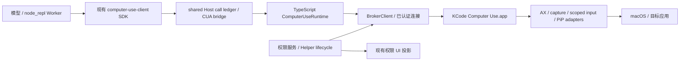
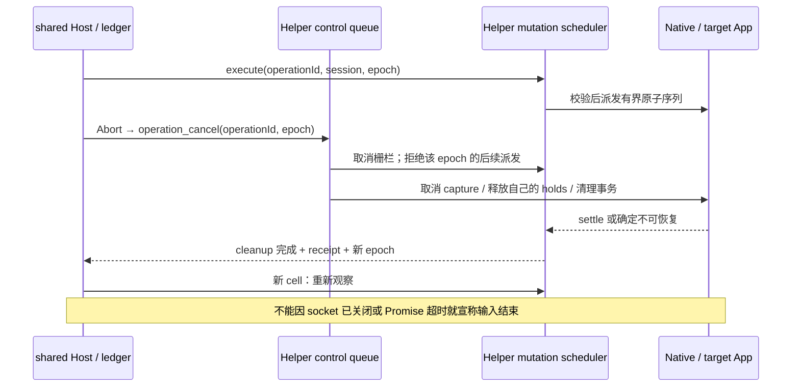
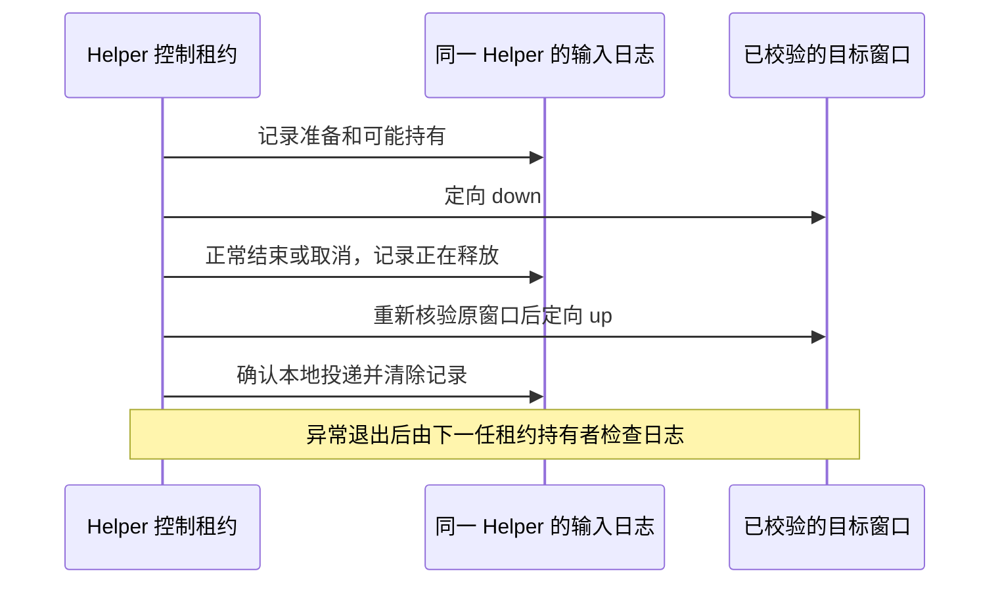
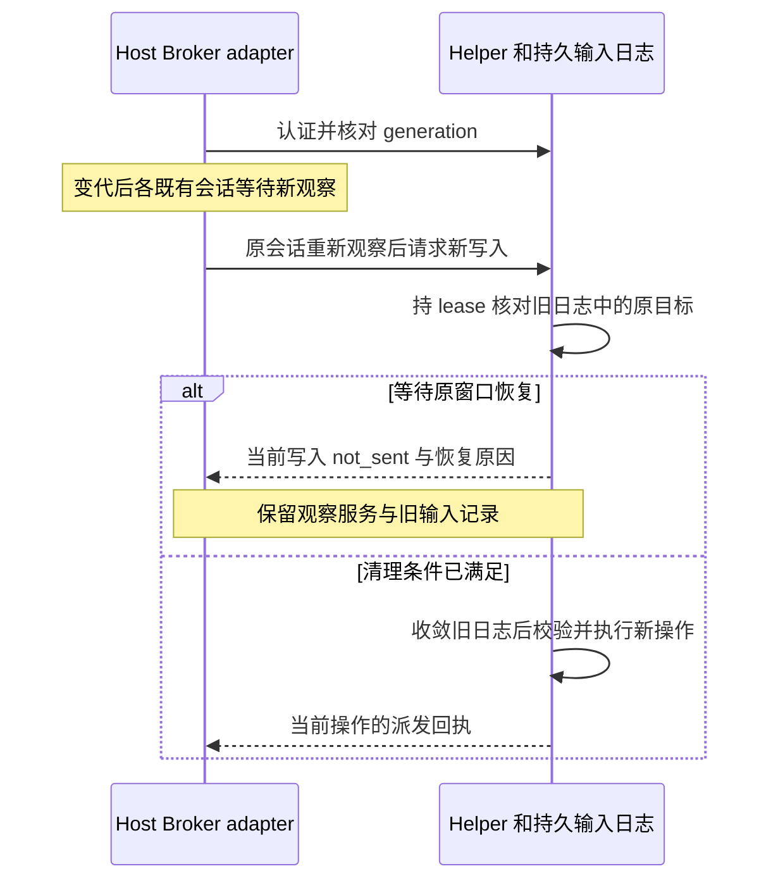
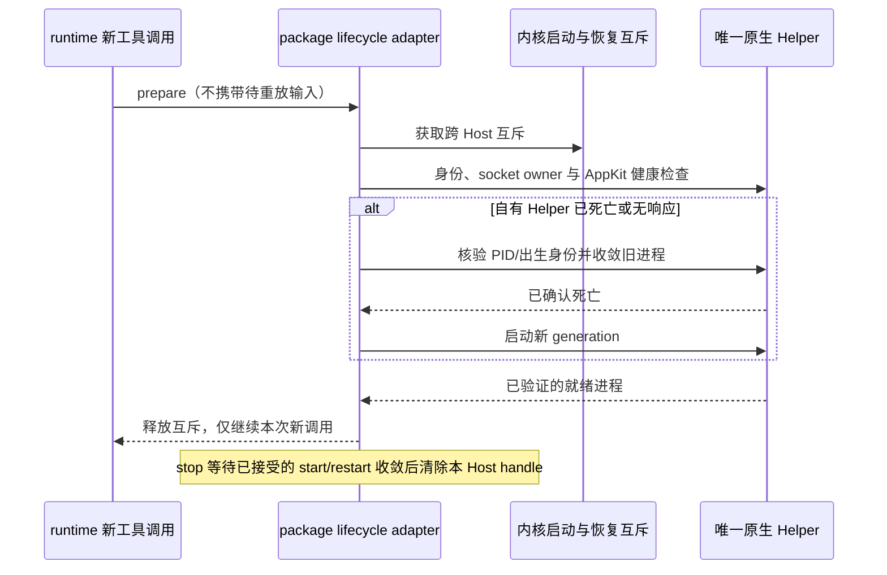
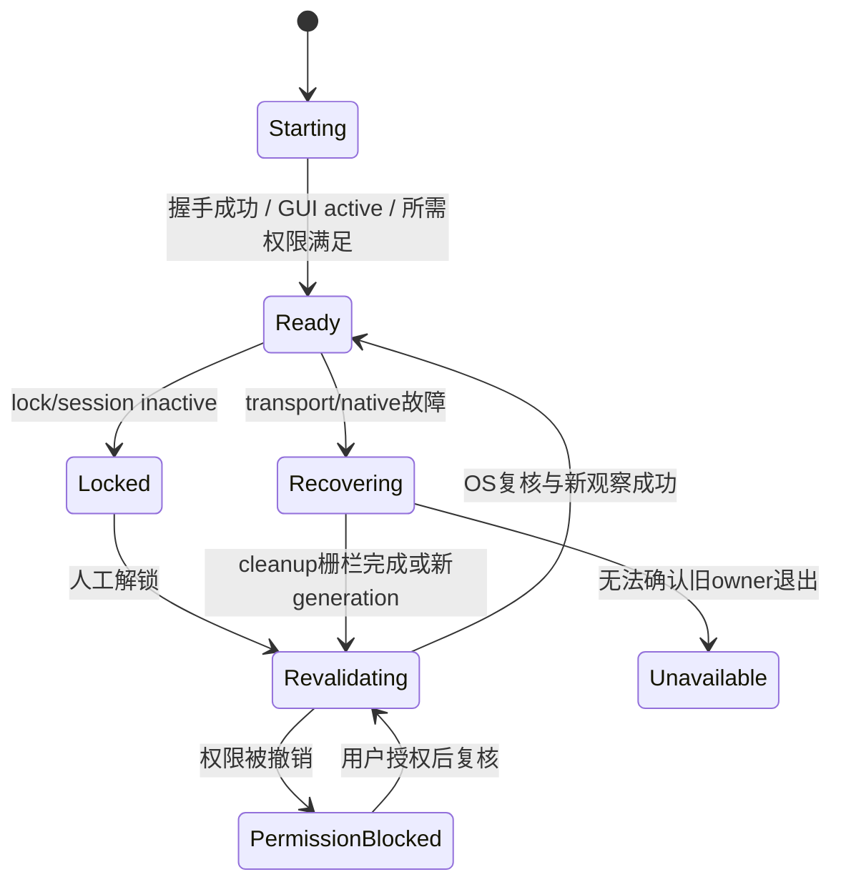
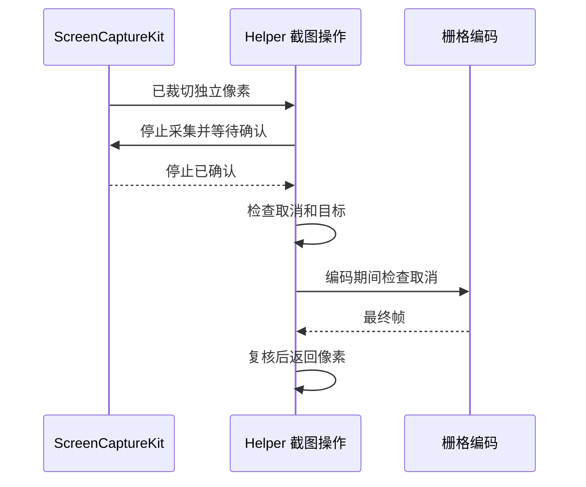

# KCode CUA：macOS 源码实现与 M2 验收设计

日期：2026-11-17。状态：用户已批准路线 A，并要求结合 AutoGLM、UI-TARS、Codex 调研直接实施；进入源码实现与 M2 验收，验收完成前不标记可交付。

## 1. 目的与完成标准

把当前仓库内的 CUA 占位包，替换为能从本仓库源码构建、安装、调试的 macOS 实现。产品名为 `kcode-cua`，替代当前从 ZCode 安装包恢复的 Helper JS、原生 addon 和可执行文件。保留 KCode 已有 SDK、Host、权限服务与模型使用方式，重点解决并验证取消后继续操作、锁屏后恢复、权限状态准确性和真实模型完整电脑操作。

“完成”同时要求源码闭包、产品接入和 M2 真机验收通过。仅能编译、只提供 MCP server、手工脚本能点击、沿用原二进制，均不算完成。此前本 Mac 上恢复版通过的验收，只是对照基线，不能证明新实现或 M2 已通过。

### 1.1 范围

- macOS：应用/窗口发现、AX 树与元素引用、目标窗口截图、点击/拖动/滚动、键盘/文本/选择/语义动作、原子粘贴、权限请求与状态、控制租约、取消清理、恢复、PiP 和 ghost cursor。
- 兼容现有 14 个模型工具、43 个 legacy Broker 方法、12 个 package exports，以及 `node_repl` 内的绑定对象 SDK。PiP、frame authority 和会话隔离属于替换范围，不能以“核心点击可用”为由省略。
- 同时维护 Desktop continuous 与手机 replayable 的既有恢复语义；手机仍 attachment 到已有 Host。
- 在 M2 从不含私有恢复产物的源码导出构建，安装签名后的 Release，运行真实配置和真实模型验收。

### 1.2 非目标与禁止的退化

- 本轮不新增 Windows/Linux 原生实现；保留它们既有明确的能力边界与入口，不把 macOS 逻辑分派给其他平台，不宣称跨平台已验证。
- 不重做 SDK 的产品 API、不恢复 30 个独立 MCP 工具、不以 Browser Use/CDP/DOM 自动化替代 CUA 真机结果。
- 不依赖 `.tmp`、`/Applications/ZCode.app`、私有 npm 包、恢复的 `ax_native.node`、JS bundle 或原版 Helper executable。
- 不通过删 lease、忽略 freshness、禁用 peer 身份验证、无限重试、自动重放输入、全局光标兜底来获得“通过”。
- 不绕过锁屏，不读取密码，不自动解锁，不修改 TCC 数据库或代用户授权。

## 2. 已确认基线、证据及未知项

### 2.1 当前源码与产物

| 依据                                                             | 已确认事实                                                                                                                                    | 对设计的约束                                                     |
| ---------------------------------------------------------------- | --------------------------------------------------------------------------------------------------------------------------------------------- | ---------------------------------------------------------------- |
| `packages/zcode-cua/package.json`、README、声明文件              | `@zcode/zcode-cua@0.6.5` 是 unavailable 占位包，build 只做 `tsc --noEmit`                                                                     | 必须提供真实源码、构建链和运行时；不能只取消 placeholder 标记    |
| 当前安装链接及 `.tmp/kcode-cua-recovery-20261116/local-producer` | 可用 runtime 来自本机恢复产物，普通安装可能恢复为 workspace 占位包                                                                            | 最终依赖图回到真实 workspace 包，去掉私有 symlink 和手工暂存步骤 |
| REA `source-inquiry/REPORT.md`、module manifest                  | Helper JS 共 33,725 行，68 个不同 CUA 模块路径；77 个片段可与原 bundle 核对                                                                   | 用于核对行为、协议和测试情形；不把编译片段视为独立原始工程       |
| Helper JS 摘要                                                   | SHA-256 `b04ffba2a8d783a00404ea0ee92ea3d8471c58d529acf46ea4d83e393296718d`                                                                    | 固定本次研究对象，禁止混用不同版本的行为结论                     |
| REA native inspection                                            | 原 addon SHA-256 `a468e3b12c9ef60c7e7452ff75253d9d80a513c4ad2c3396f0ef941b5c27cb5d`；能识别 7 个编译单元及部分调用，未取得其原始源码/构建工程 | 原生层独立实现；符号存在不等于功能已复现                         |
| 实际恢复版 manifests                                             | 14 个工具、43 个 Broker 方法，IPC version 3                                                                                                   | 早期 v3 API 文档中的 30/49 等数字不是当前 surface 的权威来源     |
| 已安装 KCode Info.plist                                          | 主应用最低 macOS 13；Helper 旧地板 12；当前 Helper bundle ID 为 `dev.zcode.cua-helper.kcode`                                                  | 明确统一产品支持地板，保持 KCode Helper 身份，不继承 ZCode 身份  |

REA 已确认的机制：原 Broker 仅按连接串行；lease 不随 socket 断线释放；`cancel_input_holds` 不等于取消全部 native 工作；read timeout 不证明 native capture 已结束；权限记录、实际功能与锁屏是不同事实。这些是设计输入，不据此声称已证明每次历史故障的根因。

研究资料原始入口在本机忽略目录中。实施第一步须把必要的协议枚举、字段契约、行为用例、来源摘要和已确认/待验证说明整理成仓库内可读的契约与 fixture；干净构建及回归不得再读取该忽略目录。保留必要来源说明，不提交完整私有 bundle、反汇编或真实用户数据。

### 2.2 M2 环境核对

SSH alias `m2` 可连接；Apple M2 Pro / arm64，macOS 27.2.1，有 console user，WindowServer 在运行。Command Line Tools 中 clang 和 Swift 可用，有本机代码签名身份。已检查的常见位置尚未找到 Node/pnpm，也未发现 `/Applications/KCode.app`。这不等于机器上绝无其他安装。

未验证：M2 是否当前解锁、TCC 授权、真实模型配置与网络可用性、新实现的功能/性能，以及 Intel 和较低版本 macOS 的运行时表现。它们不得写成通过。

## 3. Approaches：路线选择

| 路线              | 方式                                                                                           | 取舍与结论                                                                                                                 |
| ----------------- | ---------------------------------------------------------------------------------------------- | -------------------------------------------------------------------------------------------------------------------------- |
| **A，用户已选择** | 保留现有 KCode 契约，以 TypeScript runtime 和独立 macOS 原生源码重新实现。REA 用作行为核对依据 | 工作量更大，但会话、权限、控制租约、帧凭据和恢复边界能统一维护，不依赖恢复二进制                                           |
| B                 | 在本机已下载的 `open-zcode-computer-use` Swift 实现上适配 KCode                                | 它自述针对 0.5.12 MCP，尚未经过本机兼容性验证；基础能力可能更快，但不能直接覆盖当前 SDK、Helper 生命周期和 frame authority |

本文不采用 B 的代码作为默认实现来源。开发者可查阅公开框架文档、研究原理；若后续需要引入第三方实现代码，应单独记录来源/许可证和兼容性影响，不能把它当作已获批准的等价替换。

## 4. 实现形态与模块边界

### 4.1 设计者提出的具体选择

1. 保留目录 `packages/zcode-cua` 和 npm 名 `@zcode/zcode-cua`，避免消费者全面改名；README、产品描述、日志主体与 Helper 显示名使用 KCode。12 个公开 subpath 保持兼容。
2. TypeScript 持有模型侧协议与 runtime；原生部分采用 Objective-C++/C++ 的 **独立 Cocoa Helper.app**，直接链接系统框架。Helper 不再是旧 Node SEA 加恢复 addon；AppKit 主线程与后台工作队列的生命周期由我们直接控制。
3. Cocoa 主循环从进程入口正常启动，主线程只负责 AppKit 和必须在主线程处理的短任务；socket、AX、截图和输入调度均异步。不以定时调用 `finishLaunching` 或虚假心跳掩盖 GUI 不响应。
4. macOS 产品地板统一为 **13.0**，与当前主应用一致；同步 Helper plist、OS gate、文档及打包检查。截图在 macOS 13 使用 ScreenCaptureKit 的 stream 路径；较新 API 只在 availability 检查后使用，不能把 macOS 14 才有的路径当作唯一实现。
5. 支持 arm64 和 x64 的编译入口；本轮强制的硬件运行验收为 M2 arm64。x64 编译通过不能表述为 Intel 真机通过。

采用独立 Cocoa Helper 是已批准的实施选择。它改变包内部实现，不改变模型或 UI 访问入口。

### 4.4 三轮调研落实为实现约束

依据 [AutoGLM / UI-TARS 源码调研](../../cua/research/2026-11-17-autoglm-ui-tars-source-review.md) 与 [Codex 调研](../../cua/research/2026-11-17-codex-computer-use-implementation-review.md)，补充以下规则。私有 Codex/ZCode 的 JS 与二进制仅用于理解契约，不作为构建输入或复制来源。

- AutoGLM 的设备分层与 UI-TARS 的观察反馈用于组织 backend；不引入第二个模型执行循环。复用当前 KCode Host、SDK 和 call ledger。模型异常、解析失败、能力未实现均返回明确错误，不能以 finish/空结果伪造成功。
- UI-TARS 的执行重试会在已派发后重复动作，因此所有 mutation 禁止自动重放。连接恢复只服务未来请求；已断开的动作必须返回 receipt，重新观察后由调用者决定下一步。
- 借鉴 Codex 的独立原生服务、严格版本握手及受信任 Host 路由。Helper lifecycle 只保留一个启动 Promise；失败清除 Promise，身份正确的存活 Helper 直接复用，不能因 UI invalidation 或单次请求取消重复拉起。
- 在 native 执行动作前重新验证 AX 元素、PID 启动身份和窗口归属；可重新定位唯一匹配，出现歧义或目标变化则拒绝。不能只在提示词中要求模型检查。
- MCP 取消消息写出不代表 native 清理结束；以独立控制通道返回的 cleanup-complete 为 fence。Host deadline、断线、worker 退出都必须走同一清理路径。
- 区分 OS 权限事实、桌面锁定状态、功能探针和连接就绪。后台读取不触发截图和授权弹窗，fresh preflight 失败返回 unknown；UI 不得用旧 ready 覆盖新事实。
- 保持源码构建闭包。清单记录源码摘要、工具链、架构与签名主体；不依赖恢复目录、私有 npm 包、原安装应用。公开调研中的模拟验证不能计入 M2 的真实模型验收。
- Codex 可选 Locked use 依赖授权插件和受控解锁，超出本次范围。本实现锁屏拒绝新输入、保留会话；人工解锁后验证与重新观察，不安装授权插件或自动解锁。

### 4.2 调用链

Main 仍只处理原生窗口、调度与转发；不新增 task/session 业务状态。Renderer 通过现有 hook/service 使用能力。新的 package 不反向依赖 services、UI、runtime 具体实现。

### 4.3 源码组织和公开契约

`packages/zcode-cua/CONTRACT.md` 定义依赖与状态边界。`src/contract` 放 DTO/schema/manifest；`src/domain` 放纯状态机和判定；`src/app` 编排 runtime、session 和 ports；`src/adapters` 放 Node socket、安装与生命周期适配。`native/macos` 放 Cocoa Helper、原生 backend 和测试。具体文件拆分留给实施者，不能留一个巨型重建 bundle。

实现前按 architecture-governance 注册 managed module 与公开入口，替换当前 `src/**` 的宽泛历史准入。Node-only exports 与 renderer-safe `broker/ports`、纯类型/帧契约分开；不能让 renderer bundle 引入 `node:net`、原生 loader 或签名工具。仅为 Windows 使用的 addon 路径保持平台隔离，不让 macOS 继续调用 addon loader。

所有当前 exports 必须有明确去向：`.`、`frame-contract`、`host-display-contract`、`request-access-contract`、`pip-session`、`pip-session/node`、`broker`、`broker/server`、`broker/ports`、`broker/socketPath`、`broker/helperConstants`、`broker/helperHealth`。生产路径不得再返回占位成功或恒 false。已退役且没有消费者的 native-only API 可在引用审计后同步清理声明和文档；不得留下会在 macOS 主链路调用时抛 unavailable 的假兼容门面。

原生截图在签发模型 frame_id 之前完成最终编码，沿用 producer 的 **200 KiB base64 字符上限**。小 PNG 保留原字节；超限时以有界尺寸/质量组合编码 JPEG，最终尺寸与字节确定后才签发帧、摘要及坐标映射。Host 保持签发后的字节不变，不事后压缩权威帧。

### 4.5 后台输入 ABI 的实现来源与验证边界

原生 backend 独立以 Objective-C++ 编写。窗口定向事件和 synthetic target focus 的未公开 ABI 声明/事件记录布局，参考公开 MIT 项目 open-zcode-computer-use（202395e65218f83086b30daceb0f11d2f3430dd8）对 Cua Driver/yabai 的记录；只提取接口事实并重新实现隔离适配器，不引入其 Swift runtime、会话状态或进程模型。来源与许可证保存在包内 native/THIRD_PARTY_NOTICES.md，随 Helper 打包。

此项不改变路线 A 的源码闭包与所有权。所有未公开符号集中在 scoped-input.mm，动态解析且缺失时拒绝后台 event 输入，绝不回落全局事件或真实激活。synthetic focus 只通知目标进程，不调用激活/置前 API；cleanup 对称收回，并保护用户期间主动改变的前台状态。符号存在只表示可尝试，不表示功能探针通过。M2 必须通过后台浏览器实际输入/滚动、前台窗口和物理光标保持验证；未通过则不能宣称该能力可用。

## 5. 唯一状态所有者与并发规则

| 状态                                                                          | 唯一所有者                                                | 其他层的权限                                                               |
| ----------------------------------------------------------------------------- | --------------------------------------------------------- | -------------------------------------------------------------------------- |
| turn/cell admission、ledger token、AbortSignal                                | 既有 shared Host / call ledger                            | Worker 不得构造受信任的 session context                                    |
| CUA 逻辑 session、kill-switch、模型 state/frame registry                      | Host 内的 ComputerUseRuntime                              | Worker 重建不销毁；UI、SDK 不复制业务状态                                  |
| Helper 启停、安装、连接 generation                                            | 既有 services Helper lifecycle，通过 package adapter 实现 | 设置页与工具请求复用同一协调入口，不能各起一个托管 Helper                  |
| 跨进程 controller lease                                                       | native Helper lease coordinator                           | Host 只请求/读取；不能直接删 lease 或根据心跳超时偷占                      |
| 实际 mutation admission、native operation、input holds、clipboard transaction | native Helper scheduler                                   | 全部连接共享一个 mutation scheduler；原子序列中不能穿插另一 session 的输入 |
| 活的 AX references、窗口/进程身份与原生观察能力                               | native Helper observation registry                        | Host 持 opaque handle；不伪造原生句柄或把 PID 当完整身份                   |
| 模型看到的 state_id、索引和 exact-raster/frame authority                      | Host runtime observation/frame registry                   | 原生 capability 只是底层引用；不另存一份模型状态台账                       |
| OS permission、lock/session availability、capture readiness                   | native Helper 的 OS 查询/功能探针                         | 服务映射、UI 投影；缓存不成为授权事实                                      |
| PiP 焦点/turn 事件与视觉投影                                                  | 现有 PiP session coordinator；native 只渲染               | 焦点消息按 revision/sequence 幂等处理，不反写 task 状态                    |

两种观察 registry 管不同对象：Host 负责模型凭据和树索引，native 负责实际 AX 引用。native handle 必须绑定 Helper generation、session、进程启动身份、窗口与 observation generation；不能通过跨 Host 重用 handle 绕过 Host registry。

会话隔离 key 使用 `workspaceIdentity?.trim() || workspacePath`，并与 `sessionId`、`remoteSessionId` 构成无歧义 tuple；不以裸路径或简单字符串拼接替代。保留 owner/lease 与 stale-run 防护。`clientMode` / `deliveryKind` 原样传递。

controller lease 保留现有私有 runtime 目录解析和 `controller-lease.json` 的互斥边界，迁移时兼容旧 owner 的身份判定。目录 0700、文件 0600，拒绝 symlink 和错误 owner。以 PID 加进程启动身份、helper 路径等判定 owner；无 TTL 自动失效。旧 ZCode 或其他活 owner 占用时返回 busy，不擅自终止。替换安装只停止经过身份校验的旧 KCode Helper。

lease 只在派发前获取，所以获取失败的写操作一定没有发出任何输入：这类拒绝一律是 `controller_busy`，回执固定带 `action_sent=false`、`dispatch_status=not_sent`，占用方仍活着时附上它的 lease 记录（PID、进程启动身份、socket、版本）。字段由 lease 获取这一处统一补上，不依赖各条拒绝分支各自携带；读不到或无法确认归属的 lease 原样保留，只拒绝、不删除。工程层用两个真实进程争同一份 lease 覆盖：活着的对手被拒、对手退出后才能取得、持有者被强杀后可回收、两台同时起步只有一个赢家。

只读观察可以受限并发；mutation 包含输入、焦点变更、激活屏蔽与有桌面副作用的控制操作，必须跨 socket 串行。取消、健康查询和清理使用独立控制队列，不排在待取消的长操作后。AX 单次调用配置有界 messaging timeout；不得在主线程执行可能阻塞的 AX 调用。

## 6. 协议、身份与恢复栅栏

### 6.1 Public surface

模型面保留以下 14 个工具及当前严格 schema：

`list_apps`、`list_windows`、`get_app_state`、`left_click`、`scroll`、`left_click_drag`、`type`、`set_value`、`select_text`、`key`、`perform_action`、`paste`、`request_access`、`stop_computer_control`。

`getApp` 保持只绑定；同一逻辑会话、generation、取消 epoch 和目标不变时，隐藏的无截图绑定复用 Host 已持有的完整状态，不执行会淘汰模型已见原生 token 的 capture。没有可复用状态时才观察；隐藏观察不进入模型已见索引台账。`getAXState()` 返回字符串，`getAXStateAndScreenshot()` 返回含 `state` 的对象。每个 fresh Worker 重新 bootstrap，默认观察自行展示；`emit:false` 不展示，`tree_shown_to_model:false` 不进入已展示树的台账。遵循当前 cua-receipt-observation-contract：模型 get_app_state 始终取得 full structured AppState；broker 内部不得把 delta/no_change 当作可执行模型状态。保留 one-raster / image_ref 邻接契约。

### 6.2 Native transport

保留 Unix socket JSONL 和现有 public 调用适配入口。用户补充要求协议 follow zcode-cua，以便 KCode 直接适配。保留现有 **IPC version 3**：Unix socket NDJSON，每连接先 `authenticate` 再请求；`{id, method, params}`、`{id, ok, result|error}`、错误 details、`ping` 的 `serverApiVersion` 均兼容。`broker_info.api_version = ZCodeComputerUseIPC-1` 表示已有 framing 合同，不能与 serverApiVersion 混淆。43 个 legacy 方法见附录 A。取消 fence、generation 等通过认证协商的可选 `kcode` 扩展传递；已有客户端可调用旧方法，启用新恢复保证的 runtime 必须确认扩展。比服务端新的 clientApiVersion 返回 `version_mismatch`，绝不自动回落旧 binary。

握手报告 protocol version、构建标识、helper generation、PID/启动身份、bundle/signing identity、capabilities。受信任 Host 在握手后取得仅存在 Host 的会话 capability；SDK/Worker 不得取得 broker 地址、token 或 native access。控制面增加 typed `operation_cancel`、`operation_status`、`session_release`，只对已认证 Host 开放，不增加模型工具。

请求上下文至少包括 authenticated Host/client identity、session tuple、operationId、Helper generation 和 session cancellation epoch。Broker facade 生成和验证这些字段，Worker context 不可信。重试同一 operationId 查询已有状态或返回既有 receipt，**不得再次派发输入**；有界保留期结束后明确结果未知，也不能重新执行。

peer 验证包含同 UID、真实进程身份与预期签名/可执行文件 requirement；只验证 UID 或“任何 Node 进程”不够。产品允许的 Desktop、Agent Node 入口由构建 manifest 固定；development 的 unsigned 开关只对 unpackaged 环境生效。PiP 继续使用专用 presentation capability，不能凭普通观察连接控制显示。

JSON 输入执行字节上限、结构和方法白名单校验，超限明确拒绝。观察使用有界 AX tree 和文本截断，图像使用现有 frame 输出路径，不因一个超大响应无限占内存。输出确保 Unicode scalar 合法：保留完整 emoji/代理对，孤立 surrogate 输出为替换字符并计数；不改 AX identity，不删除中文。加入此前 `\ud83c` provider 编码错误形态的回归。

### 6.3 generation 与断线

socket 重连不是新 CUA session。握手返回相同 generation 时，只有经过 `operation_status` 确认 drain/cleanup 完成，才恢复 admission；有任何 dispatch 不确定性都要求重新观察。generation 改变则废弃旧 state/frame/native handles、缓存 readiness 和晚到响应，保留 Host 逻辑 session。下一次动作必须基于新观察。

断线后的未执行请求取消；已经交给 OS 的工作可能已生效，不重放。lease 不因客户端 socket 断开自动释放。Host 消亡后，Helper 对其 session 取消并清理，完成后才移除该 client；正常清理时仍有合法 client 则不退出整个 Helper。无法 drain、Helper 整体失去可信执行边界时，按 §7.3 的共享故障规则处理。

## 7. 取消、停止与“不响应”处理

### 7.1 三种操作的产品规则

| 操作                                  | 结果                                                                                         | 是否允许继续                                                            |
| ------------------------------------- | -------------------------------------------------------------------------------------------- | ----------------------------------------------------------------------- |
| 普通取消 / cell timeout / Worker 断开 | 取消该 cell 的 native operations，释放其输入保持，恢复剪贴板，排空已开始工作，递增取消 epoch | 原逻辑 session 可继续，先重新观察；不能把取消变成永久 stop              |
| `stop_computer_control`               | 取消并清理该 CUA session，session kill-switch 保持停止                                       | `js_reset`、socket 重连不能清掉 stop；只有显式建立新 CUA session 才恢复 |
| `closeSession` / runtime dispose      | 停止新 admission，取消并 drain 对应 session 或本 runtime 拥有的 session，释放引用            | 正常清理不关闭另一个 Host/session；自身关闭幂等。Helper 故障例外见 §7.3 |

Helper 的 request 状态机为 `queued → admitted → dispatching → cleaning → settled`，排队项可以直接进入 cancelled。派发判定只由 Helper 签发：确定无输入派发是 `not_sent`；至少一个可能越过 OS 边界是 `possibly_sent`；明确接受是 `accepted`。它们不是“应用效果已证明”。SDK 保留既有 action receipt 映射，`possibly_sent` 必须抛错并指示先观察。

### 7.2 有界取消与清理

- 每个 native operation 有 cancellation token；长拖动、滚动、hold 和分段输入在每次事件派发前检查 token、epoch、锁屏及目标身份。
- 协议 ACK 分为“收到取消”和“清理完成”；只有后者解锁下一条 mutation。`finishCall` 等待的是 cleanup/drain fence，不是控制消息 ACK。
- 正常取消的目标为 3 秒内清理完成。健康/权限请求使用独立短 deadline；截图单次 deadline 8 秒，AX 单次 messaging timeout 1 秒，枚举有节点/总时间上限。超时用于报告和取消，不把尚在执行的 OS 工作标为已停止。
- capture timeout 后停止其 stream/任务并等待回调清理；晚到回调按 operationId/generation 丢弃。不得在旧 capture 仍悬挂时反复启动同目标任务。
- 取消开始 5 秒后仍无法 drain，lifecycle 进入 recovery，冻结 mutation 并采集诊断；先请求受控 Helper 退出。再给 3 秒清理窗口。仍无法退出时，仅可终止身份明确的自有 KCode Helper，确认旧进程死亡后才能启动新 generation。无法确认死亡则保持 unavailable，不能并行另起控制 owner。原操作报告 possibly_sent，恢复后只观察。
- Helper input-hold registry 只释放自己派发的 key/button，并以私有 input-safety record 在长持有序列开始前记录目标身份和待清理保持；正常结束清除。Helper 异常死亡后，新 lease owner 校验旧进程死亡和目标身份，先执行这些 release 清理，再允许输入。该记录属于同一个 native registry 的恢复日志，不是 Host 的第二份输入状态，也不重放动作。
- clipboard transaction 由 native 单一所有者串行处理；支持既有 text/md/html 能力与严格格式校验。清理只在 pasteboard changeCount 仍属于本事务时恢复，不能覆盖用户或其他程序期间的新内容。取消、失败和退出均走同一清理路径。

按键或鼠标按下、正常释放、取消释放和换代恢复均使用原 PID、进程出生身份和窗口号。释放在原动作取消后仍可进行，仅发送定向的 up；窗口已消失时结束该条恢复，无法证明窗口身份时保留记录并拒绝新输入。鼠标释放使用目标窗口内的位置，窗口移动后按已校验的新原点换算。私有输入日志区分准备、可能持有与正在释放。准备阶段的记录无需发送事件。换代时只对可能持有且原窗口可核验的记录补发 up；释放投递中断的记录保留为未决，禁止猜测补发。旧日志缺少窗口身份且进程仍存活时同样保留未决。新 Helper 可先提供健康和权限查询，取得控制租约后、接受首条新输入前先处理旧日志。Host 收到进程退出时报告清理结果未知，后续仍需新观察。

M2 双窗夹具显示 macOS 可把带目标窗口标记的键盘 up 路由给同进程当前的兄弟窗口。键盘按下和释放还需复核应用实际键盘焦点属于原窗口。若焦点转移，按下返回 `foreground_required`，已持有键的释放留在日志中并返回 `cleanup_incomplete`。原窗口重新成为应用的键盘焦点后，由恢复路径先释放、再接收新输入。原窗口关闭时可收敛该条记录。图形验收同时记录目标与兄弟窗口收到的事件。

旧输入日志等待原窗口回焦、等待未决释放的窗口关闭，或暂时无法核实原目标时，由持有 lease 的 Helper 拒绝当前新输入。使用 IPC v3 既有 `action_unavailable` 错误，附加 `details.reason_code` 及当前请求的 `not_sent`，保留旧日志和旧请求的 `possibly_sent`。新请求已排空，Helper 保持同一 generation，其他 Host 可继续观察和查询。只有新输入真正进入原生工作后无法清理，或日志读写无法安全完成等故障，才进入进程恢复。出生身份查询失败只表示未知，须确认原进程或窗口已消失后才能移除该条记录。

Helper 的操作记录由调度器按 peer 和 session 所有。会话释放先封住新请求，再取消并排空已接受请求。清理全部确认后回收操作明细并保留已关闭状态和 epoch；迟到的取消或状态请求只查询。仍在排空时返回当前清理事实，排空后对未知动作保守报告可能曾派发。任何旧操作都禁止重新入队。真机长期验证超过此前每代 32,768 条操作上限，并在其他会话仍活跃时检验隔离。

单个持续打开的会话单独验收 32,768 条操作压力。保留既有容量边界与幂等键，满额时 Helper 在入队前拒绝新请求，返回 `broker_unavailable/not_sent`。Host 收到明确回执后直接结束本次调用，控制查询和会话释放仍可用。释放后新会话在同一 generation 可用，迟到旧请求不会重新执行。

主线程健康探针必须经过实际 AppKit run-loop round-trip；后台 socket 能回复不代表 GUI 响应。冷启动、取消恢复和截图超时回归均观察该 round-trip、系统 sample/spindump 与线程等待。诊断失败不增加“再等一会儿”的无限分支。

### 7.3 共享 Helper 的故障恢复例外

设计者选择保留一个共享 Helper 和一个全局输入 scheduler，不为每个会话启动独立原生控制进程。因此，“普通取消/关闭不影响其他会话”不等于“共享原生进程故障时其他会话仍能继续输入”。

当 §7.2 的 drain deadline 耗尽，必须先冻结该 Helper 上所有 mutation，通知所有已认证 client 进入 recovery，等待正在执行工作的清理/终止；即使仍有其他合法 client，也允许回收这个已不可信的自有 Helper。其他 Host 的逻辑 session、任务与用户草稿保持，不重放其输入；他们的 native refs、模型 state/frame、readiness 随新 generation 一起失效，重新观察后才能恢复。受到影响的调用返回明确 helper recovery/possibly_sent 结果，不能假报正常完成，也不能把不同 session 的派发状态混在一起。

Host 的 Broker adapter 按逻辑会话拥有写入栅栏。检测到 generation 改变时，已知会话全部进入待观察状态；观察或控制请求可以发现变代。只有该会话在当前 generation、epoch 与栅栏版本下收到供调用者使用的 AX 树或成功栅格，才解除栅栏。其他会话的观察、SDK 的隐藏绑定、无图的纯截图、列窗、拒绝写入和旧响应均不能解除栅栏。旧输入日志等待恢复的拒绝也为对应会话设置观察要求。

恢复只能有一个发起者。Helper 能响应时由控制队列签发带旧 generation 的 recoveryId；Helper 不可响应时，package lifecycle adapter 在同一私有 reclaim 互斥边界下取得恢复权，验证并等待旧进程退出。其他 Host 等待新的 lease/generation，不各自 kill/spawn；恢复锁不是第二份 controller lease。正常取消、client 退出、锁屏或权限拒绝本身均不触发全局重启。

Agent 注入的 socket 地址只标识传输入口，不表示 Helper 已经存活。`node_repl` 在清理启动环境前复制 CUA 环境；产品 runtime 对匹配该环境的传输入口，在每次新工具调用前通过同一个 package lifecycle adapter 确认 Helper 可用，使用已验证的随包源码 Helper。显式注入的测试/外部 broker 地址仍由调用者管理。退出、启动和显式重启 Promise 必须串行收敛；停止结束后不能被此前的重启重新写回 running。死亡后的新调用可以建立新 generation，原调用及 mutation 均不自动重放。

保留公开的 Agent MCP 注入契约：输入使用协议的 `{name,value}[]` 环境变量，不能展开成数字属性对象。只有 `name=node_repl`、官方 computer-use plugin ID 和当前 Host 的非空 opaque authority 三者匹配，才注入 socket/refresh marker，并替换 `--` 之前的唯一 `--permission-broker-socket` 参数；`--` 之后的用户参数保持原样。该边界不根据名字或命令子串授予权限。普通 MCP、Browser Use 和未匹配 authority 的共享 host 原样保留；已退役的独立 CUA MCP 不启动。无匹配候选时不启动 Helper，注入不修改调用者的配置。回归覆盖环境数组、重复参数、空 socket、错误 authority 与普通 MCP；真实模型的新会话接入与既有会话配置刷新分别取证。

M04/M10 必须加入双 Host 场景：A 的正常取消不影响 B；A 的不可恢复 native stall 触发一次全局冻结/恢复，B 逻辑 session 保持且旧帧失效，双方重新观察后继续，无重复 Helper、误归属收据或重放。

进程身份中的可执行路径采用文件系统解析后的真实路径，例如 macOS 的 `/var` 与 `/private/var` 是同一系统目录。安装包末级仍拒绝符号链接；身份比较不能因合法的祖先目录别名误判自有进程，也不能只比较 basename 或忽略 PID、出生身份、签名与 socket 所有权。

## 8. 锁屏、权限与用户显示

### 8.1 三类事实分开

`permission` 表示当前签名主体的系统授权；`availability` 表示当前 GUI session 是否可操作；`readiness` 表示经过哪些功能探针。API 结果携带 Helper generation、观察时间和探针是否执行，避免把 `false` 混成“未运行”和“运行失败”。在现有 service contract 上增添可选 typed 字段并提供明确兼容映射，不让 UI 自行猜测错误文案。

| 情形                        | 权限事实                 | 可用性及展示                                                               |
| --------------------------- | ------------------------ | -------------------------------------------------------------------------- |
| 授权且解锁、AX/截图探针成功 | granted                  | 已授权、可操作                                                             |
| 已授权，但未执行截图探针    | granted                  | 已授权；不能宣称截图已验证，不因 probe=false 改成 denied                   |
| 锁屏或 GUI session inactive | 保留独立查询到的权限事实 | 显示“已锁屏，解锁后可继续”；截图/观察/输入拒绝，health/cancel/cleanup 可用 |
| 锁状态无法确定              | 权限不受猜测影响         | 不可操作，reason 明确为状态未知；不能当作 unlocked                         |
| 新鲜 OS 查询为 denied       | denied                   | 显示未授权及真实 Helper 主体，不能套用旧 granted                           |
| grant 存在、AX 功能证明失效 | stale 或明确功能失败     | 显示需重新验证/修复，不把锁屏、无窗口或目标应用无 AX 归为 stale            |
| 无 Helper 或握手中          | 无当前权限结论           | 启动中/未运行，不能永久显示“已授权，正在验证”                              |

设置页在两项权限都已授权且 `desktopAvailability=locked` 时，在两行权限下单独显示“已锁屏，解锁后可继续”；未授权或锁屏状态未知时不显示，避免把 TCC 问题说成锁屏问题。

Helper 显示名固定 `KCode Computer Use.app`，bundle ID 继续 `dev.zcode.cua-helper.kcode`，主应用 `dev.zcode.app.kcode`。CFBundleExecutable 改为源码构建的 KCode 可执行文件。查询返回真实 bundle/path/signing subject；不能显示旧 ZCode 的授权。保持身份可减少不必要的迁移，但不承诺 OS 一定沿用旧授权；需要系统重新授权时如实引导。

### 8.2 锁屏与解锁

每次 capture/AX 观察和输入 admission 前实时核对 console session/锁屏状态，OS 通知仅用于失效和唤醒，不能取代 admission 时检查。已锁屏时继续兼容 `permission_denied`、`reason:screen_locked`、`action_sent:false` 的现有错误形状，同时在 typed 状态中标明 availability，避免 UI 把它当 TCC denied。

执行中锁屏则取消剩余序列、清理输入和截图；可能已经派发的部分报告 possibly_sent。隐藏 PiP/ghost，不退出 Helper、不清除逻辑 session、不释放给并行 controller。解锁后先确认 active console 和权限，再在同一 Host/session 重新观察。原窗口仍存在时重新绑定；已消失时明确返回目标不可用，禁止自动换窗口。不得重放锁屏前的动作。

这些是恢复流程概念状态；不要求另建一个与 Helper/lifecycle 各自事实重复的全局 readiness store。

### 8.3 权限查询与 UI 失效

- `request_access` 继续是 `prompted:false` 的状态快照。只有用户点击现有权限操作，才通过 Helper 的显式请求模式触发系统授权；状态轮询、warmup 和模型观察不隐式弹框。
- AX 使用实际 Helper 身份的系统 trust 查询及有界功能探针。录屏 preflight 与截图功能探针分开；默认后台状态查询不抓屏，显式开启 `probeScreenCapture` 才验证真实窗口像素。
- 对常驻进程可能滞后的录屏授权结果，使用同一签名 bundle 的短生命周期 preflight 模式重新查询。它不持控制 lease、不抓屏、不启动第二个控制服务。查询失败为 unknown，清除旧 ready；不能继续当前 services 中的 fail-open granted。必须在 M2 证明授权主体确实一致。
- 截图成功需要可信 window provenance、有效非空编码图像和预期目标证据；壁纸、锁屏画面、错误窗口、纯 preflight true 均不能算功能成功。
- 设置页进入、系统设置返回、Helper generation 改变、操作遇到权限错误、解锁恢复时触发去重刷新。UI cache/stickyReady 只作带时间的展示投影；不能覆盖新鲜 denied、unknown、locked 或 unavailable。主动探针在其结束、取消、失败时均离开“正在验证”。
- UI 若需新增锁屏/未知状态文案，先维护现有 E2E/浏览器验收，遵循 DESIGN.md、国际化和 service hook 边界；不恢复 App 业务单测。

## 9. 原生能力与观察正确性

### 9.1 AX 与窗口身份

应用身份包含 bundle ID、PID 和进程启动身份；窗口同时验证 window ID、所属应用、几何和附属表面。保留 actual window 与 presentation window 的区别，弹窗/菜单不凭主窗口旧 ID 直接操作。AX tree 保留角色、动作、值、可编辑/可选信息，限制节点、文本与遍历时间；不使用单一目标 App 的 AX 缺失结果证明系统权限失败。

读到的值必须是应用当前的状态。后台 Chromium（被完全遮挡、不跑渲染帧的窗口）不随按键推送网页内容的更新，只在该应用处理辅助功能动作时发出；直接遍历会读到输入之前的值，模型会以为文字没有输进去。所以遍历元素树读到网页内容的根（`AXWebArea`）时，先对应用元素在它的中心做一次命中测试（只读的 `AXUIElementCopyElementAtPosition`；实测请求后 12–17 毫秒值与页面一致），等更新到达再读它的子节点。没有网页内容的窗口不做这一步；只取像素的观察不遍历子树，不受影响。窗口全程被遮挡时新加载的文档不发初始树，这时观察不到网页内容，属于已知边界。

state_id、元素索引和 frame_id 继续绑定会话、目标、观察版本和栅格；模型未见过的树不进入展示索引台账。发生输入、窗口变化、取消、解锁或 generation 变化时按契约失效；关闭隐式观察不能放松 freshness。跨 cell 可以保留 Host 的状态，但必须满足原有 freshness，不能信任 Worker 自带的缓存。

Host runtime 维护会话最新像素帧。开始新的像素观察时立即撤销旧帧；无图、空白、失败和乱序旧响应均不能恢复它。将写请求交给 native 前撤销像素帧，写请求尚在途时的截图不可获得坐标权限；下一次有效像素观察恢复坐标操作。一次拖动的起点与终点在同一写请求内校验。纯 AX 观察继续复用有效的像素帧，纯截图不会撤销上次有效 AX 索引。IPC v3 保留显式和隐式帧绑定，过期时均返回 `stale_state`，动作回执为 `not_sent`。

### 9.2 截图与帧凭据

只捕获已验证的目标 SCWindow/附属表面，区分窗口 point、显示器 point、像素、backing scale 与裁切原点；多屏/Retina/负坐标均测试。Host 只对 native 证明的 exact raster 签发既有 frame credential，变换图像必须重建匹配凭据，禁止给任意 image 加 official 标记。已知边界：被完全遮挡的窗口不重绘，截图停留在上一次渲染的画面——后台输入后截图看到的仍是输入前的内容，而 AX（读 DOM）已是新值（M2 实测，模型据此把 AX 判成过期缓存）。后台场景判断文字是否落地以 AX 值为准，不以截图为准。

ScreenCaptureKit 回调只核对裁切范围并复制所需像素。原生截图操作等待 stream 停止确认，再做 PNG/JPEG 编码；编码开始前和每次压缩尝试之间检查取消，编码结束后再次核对桌面与目标。合成帧回归验证回调不调用编码器，并验证系统复用像素缓冲后，已复制帧仍保持原内容。

M2 的日志显示，在窗口流启动后约 40 毫秒请求停止会收到 `SCStreamErrorAttemptToStopStreamState`（`-3808`），且对象析构时框架仍报告流在运行。macOS 14 及以上的普通窗口截图使用 `SCScreenshotManager` 的单帧请求。截图完成回调是该路径的清理栅栏；取消等待有界的回调收敛，丢弃其图像。macOS 13 保留 `SCStream`，收到启动完成回调后才能停止。任一路径都要求窗口身份、图像尺寸和当前桌面匹配。`elements()` 只获取可见 AX 索引，不请求截图，便于截图不可用时继续进行 AX 操作。

桌面内置插件的发布版本由官方插件定义确定，SDK 的包与插件清单使用同一版本。SDK 行为改动随版本推进。冷启动时官方插件 seed 将新包原子发布到该版本的缓存目录，新任务从新目录加载 SDK。验收覆盖已有旧版本缓存的升级，比较新缓存的 SDK 与安装包内同文件的摘要。

`getScreenshot()` 由 SDK 通过现有 IPC v3 的可选扩展指明只取像素。Helper 只解析和校验目标窗口身份与几何，跳过 AX 子树遍历和索引注册。像素观察只更新帧，不淘汰模型上一棵已见的 AX 树。完整观察、默认参数、工具签名和帧权限沿用旧契约。未声明扩展能力的 Helper 保留原始观察路径。M2 用同一窗口比较纯截图与树图联合观察，分别记录图像尺寸、遍历节点数和耗时。

保留官方 image/image_ref 邻接、完整性和 one-raster 规则；通用 node_repl、Browser Use 或旧 transcript 不能获得新帧 authority。SDK 不向 Worker 暴露内部帧 credential，也不重复 emit 同一栅格。

### 9.3 输入、焦点与背景操作

优先执行语义明确的 AX action；需要事件输入时使用可验证的 PID/window-scoped backend。使用公开系统 API；确需复现 REA 已确认的 WindowServer 私有能力时，限制在独立 adapter，使用运行时 symbol/capability 检查与目标身份验证，并把对应 OS 版本标为实测范围。不能把符号存在等同于后台输入有效。

不自动转全局键鼠、不自动抢焦点。当前 macOS 模型面没有 `open_application(activate=true)` 或其他激活工具，不能引用历史文档中的这条恢复路径。优先使用现有 AX 语义动作；确实需要前台的操作返回 `foreground_required` / not_sent，明确提示用户手动建立正确前台后再观察。应用尚未运行时，保留当前绑定/观察的透明启动且 `activates=false`；隐藏或最小化导致没有像素时说明原因，保留可用 AX 路径，不能为截图强行前台化。后台用例必须证明前台窗口和物理光标没有被错误改变，不能只靠 AXPress 返回 true。

保留 macOS `typeText → paste(text)` 的精确文本路径，覆盖中文输入法、网址标点、emoji 和多行。默认/auto/event scroll 使用窗口事件，显式 a11y 保留能力判定；一页为目标窗口相应轴尺寸的约 80%，在同一原子序列中有界分段，分段前检查取消/目标身份。原版 100px 限制是对照行为，不无条件假定新 backend 也有该限制。任何部分派发失败后不自动改策略重试。

动作 receipt 只证明派发；模型每个操作 cell 末尾显式观察真实效果。浏览器 scroll 必须由页面独立记录至少半视口位移，微小位移不算完成。

`type` / `paste` 的 ⌘V 粘贴路径在此基础上核对落地：派发后读取应用焦点元素的 `AXValue`，值与派发前不同或包含文本才算 `accepted`；值可读但没变则如实报告没有落地——目标不在前台时返回 `foreground_required`，提示把窗口切到前台后重试或对元素 `set_value`；目标在前台时返回 `action_unavailable`。两者都是 `action_sent=true`、`dispatch_status=possibly_sent`、`reason_code=text_insertion_not_observed`。读不到落点元素的值或格式为 html 时，沿用“目标进程读取了剪贴板”这一条证据。

实测边界（macOS 27.2）：投递给应用的 ⌘V 只有在该应用真正在前台、窗口能接收按键时才会被当作菜单快捷键处理。应用不在前台时按键送达窗口、剪贴板也被读取，输入框不变，合成 target focus 改变不了这一点；AppKit（原生夹具、文本编辑）和 Chromium（隔离 Chrome）都是如此。用 `NSRunningApplication` 按 PID 激活成前台的 Chrome 同样没有插入，自然启动到前台的同一页面可以。实验与实测见 [M2 验证记录](../../cua/validation/2026-11-17-kcode-cua-m2.md)。

`type` 的派发方式在派发前按目标是否在前台选定，派发后不改策略重试：

| 目标     | 派发方式                                                                                                                                       | 落地证据                 |
| -------- | ---------------------------------------------------------------------------------------------------------------------------------------------- | ------------------------ |
| 在前台   | ⌘V 粘贴事务，一次写入整段文本，不受输入法影响                                                                                                  | 上面那条粘贴核对规则     |
| 不在前台 | 逐字符按键：每个 Unicode 标量发一对不带修饰键、带该字符的按键；换行发 Return，制表符发 Tab；与 `press_key` 同一条 PID/窗口定向通道，不激活应用 | 先发第一个字符并核对落点 |

后台逐字符按键的规则：

- 先发第一个带字符的按键，读到落点元素的值与基线不同才发其余字符（开头的换行、制表符不是字符，不核对）。值没变，或基线读得到而首字之后读不到，都停在这里，返回 `foreground_required` / `text_insertion_not_observed`（`action_sent=true`、`dispatch_status=possibly_sent`）。不在非文本控件上连发按键：单个字母在不少应用里就是快捷键。
- 落点元素：带定位元素的输入（`focus_native`、`click_native`）以定位的元素为落点；其余情况先取应用焦点元素，取不到时在目标窗口的辅助功能树里找带焦点标记、值为字符串的元素。查找有节点上限，找不到就只报告派发，不核对。
- 一个按键带一个 Unicode 标量。增补平面的字符（emoji 等）是两个 UTF-16 单元的代理对，必须整对发出：Chromium 对恰好一个单元的按键走按键字符，对代理对走输入法提交（合成 keyCode 229 的 keydown，再提交文本），不聚焦的后台窗口里两条路都把字符插进输入框（实测 Chrome 158）。把代理对拆成两段只会插进半个代理项；孤立的代理项按 U+FFFD 发出。已知边界：Chrome 157 在后台丢弃这条输入法提交（M2 实测两次，DOM 里也没有该字符），回执仍是已派发，模型观察会发现缺失并改用 `set_value`；AppKit 不受影响。
- 基线和首字之后的值都必须是应用当前的状态。后台 Chromium 不随按键推送输入控件值的更新：值停在上一次它自己发出待发更新的时候（给控件设辅助功能焦点会触发，按键不会），直接读会把旧值当成基线，或者读不到刚输入的首字，核对就不再是落地的证据。所以这两次读之前都先请应用发出待发更新：对应用元素在落点控件中心做一次命中测试（只读的 `AXUIElementCopyElementAtPosition`；实测请求后 12–17 毫秒值与页面一致，光标不动）。基线等到值不再因这次请求变化为止；首字之后在落地时限内重复请求。AppKit 的值本来就是实时的，请求对它没有影响。
- 基线还必须读自真正接收输入的那个控件。后台 Chromium 报告的焦点元素同样滞后：给控件设辅助功能焦点之后几毫秒到上百毫秒内，应用级焦点元素仍是上一个控件（实测给只读框输入时基线取自上一个控件，回执成了 `accepted`）。有定位元素时直接读定位的元素；没有时记下读基线的元素，核对途中焦点元素变了就说明基线取自别的控件，不拿来比较，以当前的焦点元素重新取基线，下一个带字符的按键再核对。最坏情况是多发出一个未经核对的字符。
- 只核对首字，不逐字核对。
- Tab 就是焦点遍历：网页里的最后一个输入框再按 Tab，焦点会离开网页内容（实测到了地址栏）。与用户按键一致，不保证制表符被当作文字插入。
- 后台逐字符输入一次最多 2048 个 UTF-16 单元；除换行和制表符外的控制字符在派发前拒绝（`not_sent`）。更长的文本用 `set_value`，或把窗口切到前台后粘贴。
- `paste` 工具不走这条路：它必须是粘贴，不在前台时仍返回 `foreground_required`。

验收中的人工协助边界：M07 可在单独标记的前台限定正向用例中由用户预先切换前台，并单独验证未满足条件时的 `foreground_required`；不能把这算成后台输入通过。M08 的后台窗口隔离用例必须在另一个应用仍处前台时真正完成点击、输入和滚动。M09 从任务开始到提交不允许人工点击、输入或前台化来补足能力，只允许测试约定的取消/继续和人工锁屏/解锁；系统授权与账户登录应在任务计时前完成。后台能力缺失导致 M08/M09 失败就修实现，不能追加人工步骤绕过。

### 9.4 PiP 与 ghost cursor

源码实现既有 PiP session contract、会话焦点/turn 事件去重、目标窗口缩略图和 dismiss 状态；只接受 presentation capability。ghost cursor 为可见反馈，不成为输入目标或焦点 owner。锁屏、turn 结束、session close、取消和 helper recovery 时按既有规则隐藏/更新；多显示器/Space 坐标变化不得使用旧表面。视觉功能出错不能造成额外 controller 或绕过权限。

macOS 上启动 Helper 的每条路径都带 `--pip-mode`，包括设置页只读探测拉起的常驻 Helper：它是进程级能力开关，之后的真实操作会复用同一进程，漏传则 PiP 握手返回 `version_mismatch`。握手不匹配的传输只禁用到当前回合结束，下一个 `turn-started` 重新握手一次；同一 socket 背后的 Helper 进程会在 Host 存活期间被替换。

PiP 目标在回合内的每次观察（带 `pip_session_context` 的 `capture_app`）时登记，不以 Helper 持有控制 lease 为前提：只做观察、没有任何写操作的回合同样出现面板，画面是该会话最近观察到的窗口。控制 lease 只用来串行化写操作；面板只读，不派发输入，也不构成额外的 controller。面板在第一帧画面到达时才创建，没有画面的回合不建窗口。

Helper 由回合内的首个 CUA 调用懒启动，而 `turn-started` 与带会话 id 的 `focus-changed` 都早于它。这两条没能送达的事件在回合内保持待补发，直到同一回合的 `turn-ended` / `session-closed`、新的 `turn-started` 或服务销毁；不设固定过期时间。凭据可用后先补 `turn-started`、再补最近一条 `focus-changed`，Helper 才同时有开着的回合和活动会话来承接随后的截图。

## 10. 构建、签名、安装与切换

当前 `pnpm build:cua` 改为真正构建 workspace package；新增的 native/helper 构建和测试入口必须写入目标 package 的 package.json，再在文档中引用。不能把尚不存在的命令报告为已可运行。

构建闭包包括 TS dist、原生 Helper.app、资源、Info.plist、协议/capability manifest、版本与来源标识、签名清单。使用仓库锁文件和固定工具版本；native 可由 Node build script 异步调用 `xcrun clang++`/系统工具构建，无需引入独立 Swift/CMake 工程。macOS 上不再跳过真实 Helper 构建，也不再用字符串补丁修改原版 bundle。旧 patch 工具、测试和占位检测中与新实现冲突的逻辑同步清理，保留无关平台能力。

在新目录从导出的已提交源码构建，禁用所有私有恢复路径并检查最终依赖、symlink realpath 和产物 manifest。运行同一源码/依赖版本可重建；签名和时间戳导致的二进制字节差异需单独记录，不把“可复现构建”混同于签名文件逐字相同。

签名使用构建机器现有可用身份，主 App、Agent/Helper 可执行闭包满足 peer requirements；不导出或搬运私钥。保留稳定 bundle identity 和安装路径。M2 的 Release 安装位置固定为 `~/Applications/KCode.app`，独立 Helper 为 `~/Applications/KCode Computer Use.app`；发现同路径已有安装则保存可回滚副本。嵌入 Helper 路径仍通过现有 installer contract 解析，安装器校验架构、签名、bundle/protocol/build identity 后原子切换，失败保留旧完整安装。

同路径已有安装校验不通过时同样按需替换，被替换的一份保留为最近一次的可回滚副本，包括没有来源清单的更早版本和封印资源与签名不符的安装。首次安装与替换在按安装目标的跨进程锁内完成，持锁后复核是否仍需安装。稳定路径上有运行中的旧 Helper 时报 `upgrade_required`，由 Host 核对 PID、出生时间和可执行路径后终止再替换；安装目录或可执行文件是符号链接时无法确认进程归属，只报错，不自动终止。

本轮只在 M2 切换验证版；不顺手覆盖当前本 Mac 上的已用版本。新路径首次 TCC 授权由用户完成。回滚是显式恢复完整旧安装，不允许新 runtime 在运行时偷偷加载旧 ZCode native。

## 11. M2 验收与证据合同

### 11.1 准备

1. 在独立验证目录检查 SSH、GUI session、磁盘、SDK、签名工具、Node/pnpm。按 mise.toml/锁文件准备缺失工具，记录真实版本；不复用本机 `.tmp` producer。
2. 导出指定 commit 的源码，干净安装并构建。验证 `@zcode/zcode-cua` realpath 指向本次 workspace，最终产物没有 ZCode 原始 helper/addon/bundle 摘要或私有路径依赖。
3. 对 Release 签名和安装，真实启动一次进行用户授权。之后的冷启动不得以开发环境变量补齐缺失资源。
4. 发现并使用 M2 已有合法模型配置，不打印凭据，不提交配置。真实模型默认与之前对照一致使用 GLM-5.3；若 M2 无可用账户/模型，记录阻塞并让用户完成现有登录/配置流程，不能用 mock 模型替代必验项。
5. 锁屏测试由用户真实锁屏/人工解锁配合，报告等待状态；不能把长时间等待人工解锁计入处理性能。

### 11.2 必须全部完成的场景

| ID  | 场景                               | 独立判据与证据                                                                                                                                                                                                      |
| --- | ---------------------------------- | ------------------------------------------------------------------------------------------------------------------------------------------------------------------------------------------------------------------- |
| M01 | 源码闭包与 surface                 | 干净构建成功；12 exports、14 tools、43 legacy methods 契约覆盖；无私有原始产物；arm64 Release 来源 manifest                                                                                                         |
| M02 | 真实配置冷启动，连续 3 次          | 每次先正常退出全部自有进程并确认，不清用户配置；从安装目录经 LaunchServices 启动；无开发 env、无现存 helper；记录启动/握手/权限与 main run-loop。正常已授权条件下 Helper 10 秒内可握手，App 15 秒内可交互           |
| M03 | 取消排队、执行中与 cell timeout    | 排队取消、长 scroll/drag/hold、paste、capture 各测；正常 cleanup 3 秒内；结果 not_sent/possibly_sent 准确。相同 Host/session 接着新观察与输入成功，无卡键、残留按钮、剪贴板覆盖或迟到输入                           |
| M04 | 断线与跨 generation 恢复           | 断 Worker、断 broker socket、终止自有 helper、注入 capture/AX stall；健康/取消不被堵住。恢复按 drain 或新 generation 栅栏；旧帧和晚到结果被拒；无重复动作/并行 owner，升级恢复不超 8 秒仍未知则明确 unavailable     |
| M05 | 同 Helper 锁屏→人工解锁，至少 2 轮 | 同 Host/session/PID 记录；锁屏新观察/截图/输入拒绝且 not_sent；健康/取消成功；解锁后新观察、截图和输入成功，无重启要求、无锁前动作重放。另测执行中锁屏的 possibly_sent 与清理                                       |
| M06 | 权限状态矩阵                       | AX/录屏分别授权、撤销、重新授权；设置页实际展示与 fresh preflight/功能探针对照；验证真实主体、unknown、locked、probe未运行、无窗口。拒绝/失败不能被 sticky cache 改成 ready；后台轮询不弹授权、不抓屏               |
| M07 | 14 工具及原生能力                  | 可重复 fixture/真实应用覆盖所有保留工具、文本选择、key/hold modifiers、拖动、text/md/html paste、窗口弹窗、显式前台需求；不支持目标动作给出契约错误，不能伪造成功                                                   |
| M08 | 浏览器真实操作和窗口隔离           | 浏览器打开本机验收页；中文 IME 下输入 URL、中文/emoji/多行、勾选、滚动≥半视口、滚到底并提交。服务端独立记录值/scroll/viewport/提交；另一个前台窗口与光标不受后台误操作                                              |
| M09 | 真实模型完整端到端，至少 3 轮      | 使用已安装版 KCode 的真实默认配置和普通 node_repl/CUA SDK，不用外部脚本替模型操作；每轮使用新 nonce，网页 oracle 证明正确提交。覆盖普通流程、一次真实取消后续接、一次锁屏解锁后续接；模型重观察允许，自动重放不允许 |
| M10 | 会话/远控/帧权限隔离               | 两 Host/会话、同路径不同 identity、subagent 拒绝、stale frame/window PID复用/跨 session引用、generic image伪造；Desktop continuous 与手机 replayable 的真实 attachment 恢复均验证，不为手机另起 runtime             |
| M11 | PiP、ghost 与“不响应”稳定性        | 焦点/turn/dismiss、多屏坐标 fixture与可用硬件真机、Space切换；至少 30 分钟连续操作，包含 20 轮取消→继续，期间 GUI round-trip 不持续丢失。系统采样证明主线程未堵在 AX/capture/drain；异常路径无无限积压/僵尸 helper  |

M02 的冷启动不包含首次授权弹窗；M05 正常锁屏不应改变 PID，M04 故障恢复则允许 generation/PID 改变。无法运行的场景标记未完成，不能因功能脚本或此前本机结果通过而替代。

**必须项收敛（2026-11-26，用户批准「跑必要的」）**。原表按自托管单机实际使用方式收敛，收敛后的必须项：

- M02：冷启动 2 次（原 3 次）——两轮已完成并记录。
- M05：锁屏→解锁至少 1 轮（原 2 轮）。锁屏侧验证新观察/截图/输入拒绝且 not_sent、健康与取消仍可用；解锁后无需重启即可恢复。执行中锁屏的 possibly_sent 与清理已有回归夹具（input-release、paste-transaction）。
- M07：保留“可重复 fixture 覆盖保留工具”这一条，以现有原生夹具与回归测试为准（14 工具经契约测试与真实模型场景覆盖；不支持目标给出契约错误）。
- M08：浏览器真实操作一轮：验收页上 nonce 文本、多行、勾选、滚动≥半视口、滚到底提交一次，服务端独立记录核对；另一前台窗口与光标不受后台误操作。emoji 在 Chrome 157 后台按已知边界记录（§9.3）。
- M09：真实模型端到端 1 轮（原 3 轮），可与 M08 同轮完成；记录真实模型/服务端版本、成功率、耗时、工具调用数、重观察与错误数。
- M11：PiP 的焦点/turn/dismiss 与只读观察回合已由真实场景覆盖（含 2026-11-26 的 D 场景）；30 分钟连续 soak 与 20 轮取消→继续移出必须项。

移出必须项（不阻塞合并，按需再做）：M03/M04 的全量故障注入矩阵（取消栅栏与 lease 竞争的核心路径已有回归夹具与 M2 记录）、M06 的权限撤销/重授矩阵（撤销 TCC 的采样用户已明确不做；权限事实与设置页展示已验证）、M10 的双 Host 与手机 attachment（当前不使用手机远控）。收敛不影响 §12 的完成标准：收敛后的必须项全部跑通前状态仍为未完成。

签名私钥保留在已有钥匙串所在主机；允许在构建 Mac 使用其可用身份为主应用及 Helper 统一签名，再传输已签名产物到 M2。M2 独立源码编译证据、发布产物来源和实际叶证书分别记录，不把公证或另一台机器的运行结果推断为 M2 验收，也不复制私钥、账户配置或密码。M2 首次安装该签名身份后的授权仍须在本机真实完成。

M09 记录真实模型/服务端版本、任务成功率、端到端耗时、模型调用数、工具调用数、重观察/错误数、token用量（服务提供时）、取消和恢复延迟。恢复版历史结果用于已知行为对照；不同机器和模型时间不能作为严格性能 A/B 的因果证明。不以单轮耗时下结论，不预先承诺提升。

M08/M09 复用仅监听回环的验收页。每轮启动独立 fixture，服务端核对标记文本框中的 nonce、多行内容和勾选状态，并记录浏览器上报的滚动几何。通过要求滚动距离达到半个视口、提交时已到达页底、所有字段与本轮输入一致且只提交一次。验收脚本仅轮询服务端记录，页面内所有交互由被测 CUA 完成。

### 11.3 测试层次与执行报告

- 工程层：新增/更新 CLI、CUA/native 和工程门禁测试，覆盖状态机、协议、取消 fence、late result、Unicode、lease 竞争、输入清理与构建闭包。允许受控 fake backend 注入 stall，不能把 fake 结果作为真机通过。
- App 交互层：先维护现有电脑控制 E2E 和浏览器验收，再改相关 UI；不新增或恢复 App 业务单测、`contract.test.ts`。
- 必须实际运行 `pnpm typecheck`、`pnpm lint`、相关格式/架构检查及目标 package 的真实测试入口。React 改动额外复核 hooks 诊断；已有失败/告警与新增问题分开报告。
- 真机层：M01–M11 每项有机器/OS、commit/build、安装路径、签名主体、Host/session/Helper generation、时间线、receipt、oracle 与必要截图/采样。证据索引明确 passed/failed/blocked/not-run；敏感内容脱敏，不能提交凭据和真实用户会话。

## 12. 实施顺序、交付与留给实施者的决定

批准本文后编写实施计划，顺序为：契约/来源 fixture 与 managed module → native Helper 事件循环/身份/健康 → lease与独立控制通道/取消 fence → AX/capture/input → 现有 SDK、frame与PiP接入 → 权限 UI 与安装切换 → 干净构建和 M2 全量验收。每一步形成可验证的纵向切片，但最终验收要求完整替换。

交付包括源码和构建入口、更新的 public contract 与 docs、回归 fixture/测试、签名 Release 与安装说明、M2 证据索引和失败/限制清单。所有必须验收项跑通前，状态保持“未完成”。

留给实施者：文件粒度、内部数据结构、有界缓存容量、测试框架的现有入口选择、AX traversal 优化和已声明 deadline 内的轮询间隔。不得自行改变 platform floor、Helper 身份、普通取消与 stop 的区别、后台输入边界、自动重放规则、状态所有者或 M2 必验范围。

设计交付前的独立 builder check 提出的两个问题已明确：macOS 不存在模型激活工具，真实模型验收的人工协助边界见 §9.3；共享 Helper 的不可恢复故障允许全局冻结并换代，普通取消保持会话隔离，见 §7.3。这两项是设计者的具体取舍，随本文一并交用户审阅。独立审阅者复核后未发现影响编写实施计划的重要未决问题。

## 附录 A：当前 43 个 legacy Broker 方法

本表取自本次 REA 固定摘要对象的 `BROKER_METHODS`，并与当前 consumer 引用核对；兼容协商的内部控制扩展不伪装成 legacy surface。不能根据旧设计文档补回已退役探针。

| 类别            | 方法                                                                                                                                                                                                                                                                                                     |
| --------------- | -------------------------------------------------------------------------------------------------------------------------------------------------------------------------------------------------------------------------------------------------------------------------------------------------------- |
| 诊断/权限（10） | `broker_info`, `controller_status`, `controller_takeover`, `controller_stop`, `request_access`, `permission_status`, `input_permission_status`, `screen_capture_status`, `screen_capture_probe`, `supports_accessibility`                                                                                |
| 观察（6）       | `list_applications`, `application_info`, `list_windows`, `capture_app`, `element_at_point`, `read_element`                                                                                                                                                                                               |
| 输入/语义（18） | `click`, `scroll`, `drag`, `type_text`, `type_text_to_app`, `press_key`, `press_key_to_app`, `hold_key`, `hold_key_to_app`, `cancel_input_holds`, `element_press`, `element_show_menu`, `element_focus`, `element_set_value`, `element_perform_action`, `element_select_text`, `element_scroll`, `paste` |
| 激活控制（3）   | `prevent_activation`, `reenable_activation`, `is_focus_steal_prevented`                                                                                                                                                                                                                                  |
| PiP（6）        | `pip_start`, `pip_stop`, `pip_is_running`, `pip_clear_dismissed`, `pip_session_handshake`, `pip_session_event`                                                                                                                                                                                           |

## 附录 B：参考与适用优先级

当前源码/声明/实际 manifest 高于历史设计数字。与本文冲突的旧说明须在实现时同步更新，不保留相互矛盾的指令。

- `docs/cua/2026-08-24-cua-node-repl-sdk-migration-spec.md`，尤其 2026-11-17 的锁屏、滚动、receipt 与返回值说明。
- `docs/cua/producer/cua-receipt-observation-contract.md`、`frame-coordinate-internal-binding.md`、`macos-app-frame-surface-provenance.md`、`macos-background-input-mode.md`。
- `docs/cua/producer/pip-session-coordinator-v2.md`、`multi-session-cursor-overlay-spec.md`、`subagent-runtime-scope-boundary.md`。
- `packages/services/src/node.ts`、`packages/services/src/cua-permission-broker`、`apps/zcode-cli/packages/node-repl-host/src/cua-broker.ts`、`apps/zcode-cli/packages/zcode-cua-plugin/scripts/computer-use-client.mjs` 与现有 CLI/CUA 测试。
- REA 本机报告：`.tmp/kcode-cua-recovery-20261116/source-inquiry/REPORT.md`、`HELPER-MODULES.md`、`helper-module-manifest.json`、`native-inspection.json`。它们是研究证据，不是构建依赖。
- 系统 API 依据：[AXUIElementSetMessagingTimeout](https://developer.apple.com/documentation/applicationservices/1459345-axuielementsetmessagingtimeout)、[ScreenCaptureKit](https://developer.apple.com/documentation/screencapturekit)、[Capturing screen content in macOS](https://developer.apple.com/documentation/screencapturekit/capturing-screen-content-in-macos)。具体 availability、错误及取消行为仍须以构建 SDK 和真机测试为准。

### 权限样本与桌面 epoch（实现接线）

Helper Host 通过 LaunchServices 启动同一已验证 bundle 的短命进程读取 AX/录屏 preflight；结果经私有目录返回。失败或非法响应必须成为 unknown/不可用，不能沿用常驻进程的 granted。后台查询不请求权限、不截图；`includeFunctionalProbes` 或 `probeScreenCapture` 只在显式用户路径运行功能探针。

服务保留同一权限所有者，向 UI 透传 `helperGeneration`、`desktopEpoch`、`desktopAvailability` 与 `freshPreflight`。sticky 功能结果只在同一 generation、同一桌面 epoch、明确 unlocked 且当前双项 granted 时复用；历史缓存不携带已验证探针。模型 `request_access` 返回当前事实和授权说明，不自动弹系统授权。

macOS 桌面事实兼容 root.IOConsoleLocked + 同 UID console owner；缺失或其他用户的会话仍 fail closed。锁定后 epoch 变化即使 UI 没有在锁屏期间查询也会使旧探针失效。

正式 peer 使用系统验证后的签名叶证书 DER 精确匹配（兼容没有 TeamIdentifier 的本机签名），并验证真实 Main 的进程出生身份、bundle path 与父进程链。当前源码的 Agent 使用 Electron Node，无独立外部 Node 白名单；Main/Host 的 identifier 必须属于 KCode。Main 和 peer 的路径使用同一规则解析 macOS 文件系统别名后，peer 路径必须在已验证 Main.app 的 Contents 下。解析后指向包外的目标拒绝。presentation 仅授予 GUI Main 和由该 Main 直接启动的 Host；任意 Node、错误父进程或仅同 UID 均不能通过。开发例外只对 ad-hoc Helper 的显式参数有效。
